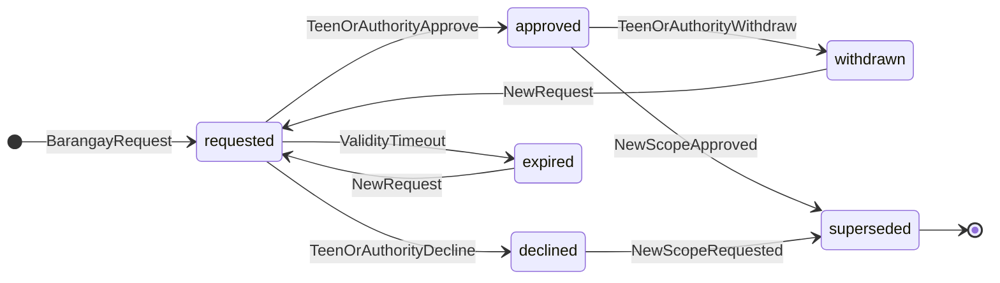
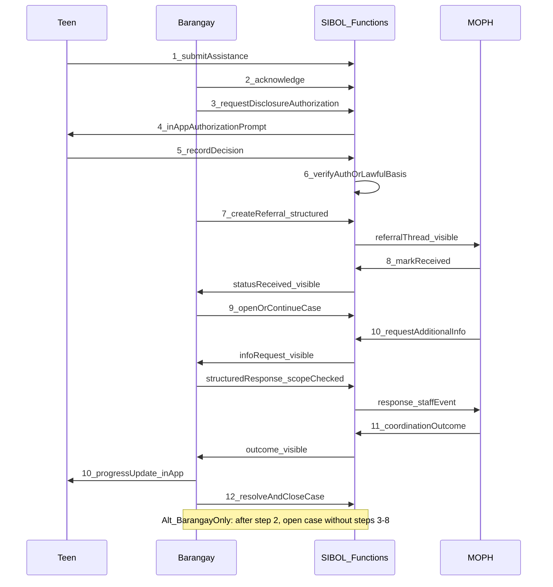

# SIBOL-CONSENT-REFERRAL-001 — Architecture plan (EDF)

**Status:** PLAN REFINED — implemented per handover `d4a8c261-7e35-4d92-9b60-f1c73a80e524`


# SIBOL-CONSENT-REFERRAL-001 — Integrated consent, referral, and case lifecycle plan

**Status:** **PLAN REFINED — PA ACCEPTANCE PENDING**  
**Refinement handover UUID:** `8f6d4e20-93b7-4a1c-b6d2-79e52a18f043`  
**Original handover UUID:** `c2e75b40-19a6-4f83-9d24-6e8b3a570c91`  
**Plan artifact (Cursor):** [`consent_referral_architecture_925a5fcf.plan.md`](/Users/edbecnel/.cursor/plans/consent_referral_architecture_925a5fcf.plan.md)  
**EDF mirror (post-AGENT authorization):** [`Docs/Development/SIBOL_CONSENT_REFERRAL_001_PLAN.md`](Docs/Development/SIBOL_CONSENT_REFERRAL_001_PLAN.md)  
**Verified baseline:** Git `ea3fdd71581df49138e9cacb4db0f36b96be9c64` on `main`. Unrelated iOS WIP preserved. **No implementation, deployment, commits, or production operations occurred during this refinement.**

**Traceability:** Extends [SIBOL-CASE-LIFECYCLE-001](Docs/Development/SIBOL_CASE_LIFECYCLE_001_IMPLEMENTATION_SPEC.md) and [SIBOL-CASE-COORD-001](Docs/Development/SIBOL_CASE_COORD_001_PLAN.md); preserves [ADR-0005](Docs/Architecture/ADRs/ADR-0005-Case-Coordination-Minimum-Information.md) (DEC-CASE-001).

---

## Approved Product Owner decision register (D1–D9)

| ID | Decision | Architecture implication |
|----|----------|---------------------------|
| **D1** | **E1 workflow** | UI guides: authorization → referral → MOPH `received` → case open. **Server** enforces disclosure authorization. Case open remains allowed after acknowledgment **without** requiring MOPH `received`. |
| **D2** | **Declined authorization** | Does **not** close assistance or block Barangay-only case management. Minimum-information MOPH referral permitted only when content stays within minimum-information boundary (R1) and lawful basis permits; **no** authorized identifying attachment. |
| **D3** | **Category catalog** | Versioned `disclosureCategoryCatalogVersion` + explicit category codes; initial candidates: `legal_name`, `date_of_birth_or_age`, `contact_phone`, `contact_email`, `other_essential` (requires individual justification + teen approval of that category only). Never auto-authorize all fields. |
| **D4** | **Minors / guardian** | Pluggable `decisionAuthority` model; no universal guardian rule or teen-only rule. Unresolved legal capacity → **fail closed** for consent-dependent disclosure. |
| **D5** | **Statutory / emergency** | **No** general Barangay override. Separate `lawfulBasisDisclosures` procedure with restricted roles, justification, audit — **feature flag off** until legal basis and authorization rules approved. |
| **D6** | **Additional information** | **Structured, category-scoped** exchanges preferred. New authorization when recipient, purpose, categories, or validity exceed existing authorization. |
| **D7** | **Teen notifications** | In-app authorization requests, decisions, progress updates via Firestore teen-visible paths. **FCM deferred.** |
| **D8** | **Normative documentation** | Incorporate PO framework into EDF after **verified** revision label inside source file. Repository file: [`Docs/Architecture/SIBOL_Case_Lifecycle_Consent_and_Privacy_Framework.pdf`](Docs/Architecture/SIBOL_Case_Lifecycle_Consent_and_Privacy_Framework.pdf) (and `.docx`) — **currently untracked**; PDF metadata dated 2026-10-31; **do not call it “Revision 2” until PA confirms text inside document.** |
| **D9** | **Deployment boundary** | All enhanced functionality **emulator / isolated harness only** until separate PA approval and acceptance. **No** `sibol-286d0`, **no** three student demonstration phone changes. **November 3 demonstration:** use pre-enhancement baseline or emulator-only enhanced build only if explicitly authorized in a future handover; default safeguard = no production/demo-phone mutation. |

---

## 1. Repository baseline and trust boundaries

(Unchanged inventory — see Work Package A below.) Coordination writes remain **server-only**; MOPH denied `private/binding` and teen assistance narratives per ADR-0005.

---

## 2. Work Package A — Current implementation inventory

(Summary retained from prior plan pass.)

| Area | Implemented today | Key paths |
|------|-------------------|-----------|
| Assistance submit/ack | Yes | `regSubmitTeenAssistanceRequest`, `regAcknowledgeTeenAssistanceRequest` |
| Referral | Yes, ack-gated | `createCoordinationReferral` — summary free text 10–2000 chars |
| MOPH ack / coordination | Yes | `regUpdateMophCoordinationStatus` (`received`, etc.) |
| Info responses | Yes | `regBarangayRespondToMophInformationRequest` — **free text to staffEvents** |
| Case open | Yes, ack-gated | `regOpenBarangayCaseFromAssistance`, `assistanceCaseBindings` |
| Referral without case | Yes | Registry keyed by `assistanceRequestId` |
| Teen coordination UI | No | `teenCoordinationLinks` written, not read in Flutter |
| MOPH disclosure authorization | **No** | Registration `privacyConsentAt` ≠ hospital disclosure |
| Free-text PII control | **Warnings only** | ADR-0005 consequence #4 — **gap addressed by R1** |

---

## 3. R1 — Free-text disclosure safety (mandatory)

### 3.1 Problem

Operator warnings on [`barangay_coordination_referral_screen.dart`](sibol_app/lib/features/coordination/presentation/screens/barangay_coordination_referral_screen.dart) and unstructured `responseSummary` cannot enforce authorization boundaries. Regex/classifiers **cannot** guarantee detection of all personal information — **do not rely on semantic filters as primary control.**

### 3.2 Enforceable boundary model

Two **mutually exclusive** coordination content modes on every MOPH-visible write:

| Mode | `disclosureMode` | MOPH-visible narrative fields | Identifying fields |
|------|------------------|--------------------------------|--------------------|
| **Minimum-information** | `minimum` | **Structured template only** — no open-ended PII fields | None (existing header: category, barangay label, `displayRef`, phase, status) |
| **Authorized identifying** | `authorized` | Same structured template (administrative, non-identifying) | **Only** server-copied fields in `authorizedDisclosure/profile` per approved category codes |

**R1 design change (extends prior plan):**

1. **Replace** unconstrained `barangayReferralSummary` for new referrals with:
   - `referralPurposeCode` (enum from catalog),
   - `coordinationNeedSummary` — **structured**: picklist reason codes + optional bounded non-identifying note (max 500 chars, **server rejects** if note matches conservative denylist patterns for email/phone/11-digit sequences — **assistive only**, not sufficient alone),
   - **Primary control:** note field **disallowed entirely** when `disclosureMode == minimum` **OR** require note to be empty and force all identifying content into authorized profile path only.

2. **Replace** free-text `responseSummary` for additional-information responses with:
   - `responseTemplateCode` + optional `administrativeNote` (same bounded non-identifying rules),
   - **`disclosedStructuredFields`** map keyed by category codes — populated **only** from server after authorization scope check (Barangay selects categories to disclose; server copies values from authoritative teen profile).

3. **Staff events:** `staffEvents.body` for MOPH-visible events becomes **generated server-side** from structured inputs (human-readable summary without raw operator paste). Barangay never writes staff event bodies directly.

4. **Notifications / teen progress:** [`teenCoordinationLinks`](sibol_app/lib/core/constants/firestore_paths.dart) — generic labels only (`progressCode`, `progressLabel`); **no** echo of referral note text or authorized field values.

5. **Audit logs:** `auditEvents` for disclosure record `authorizationId`, `categoryCodes[]`, `disclosureMode`, `threadId` — **not** field values or free text.

6. **Offline queued payloads:** Queue stores **operation intent** (assistance id, template codes, selected category codes, `authorizationId`, idempotency key) — **not** cached identifying values. Sync re-fetches authorization state and copies profile server-side (R6).

### 3.3 Historical records

- Existing threads retain legacy `barangayReferralSummary` and free-text staff events — **read-only, not rewritten**.
- UI labels them **legacy free-text coordination** with operator caution.
- New referrals after enhancement use structured contract only; backward compatibility in **read** paths only.

---

## 4. R2 — Authorization state machine and continuity of care

### 4.1 States (`disclosureAuthorizations.status`)



| State | Assistance request | Barangay case | MOPH minimum referral | MOPH authorized profile |
|-------|-------------------|---------------|----------------------|-------------------------|
| **requested** | Open | May open (D1/D2) | Block if Barangay attempts `authorized` mode; minimum allowed if templates satisfied | Block |
| **approved** (valid) | Open | May open | Allow minimum anytime | Allow on referral/response when categories ⊆ authorized |
| **declined** | Open | May open | Allow **minimum only** (D2) | **Block** |
| **expired** | Open | May open | Treat as no approval — minimum only | Block |
| **withdrawn** | Open | May open | Minimum only going forward | Block **future** copies; past events retained (R4) |
| **superseded** | Open | May open | Governed by replacement auth | Old auth invalid |

**Refusal does not** transition assistance to closed or cancel an open case.

### 4.2 Transmission gates

| Action | Server check |
|--------|--------------|
| `createCoordinationReferral` `minimum` | Acknowledged + structured payload valid + **no** `authorizationId` + note fields empty/disallowed |
| `createCoordinationReferral` `authorized` | Valid `authorizationId`: `approved`, not expired/withdrawn/superseded, hospital match, categories non-empty ⊆ authorized |
| `regBarangayRespondToMophInformationRequest` | Structured response; each disclosed category ⊆ active authorization or approved lawful-basis record (D5, when enabled) |

---

## 5. R3 — Decision authority model (minors and legal capacity)

| `decisionAuthority` | Meaning | Consent-dependent disclosure |
|---------------------|---------|------------------------------|
| `teen_self` | Teen recorded decision; server verified `auth.uid == teenUid` | Allowed when legal capacity satisfied per policy module |
| `guardian_verified` | Guardian/representative decision recorded with verification evidence refs | Allowed when policy + evidence fields complete |
| `other_legal_authority` | Court/order/other authority — evidence document refs | Allowed when verified |
| `pending_verification` | Awaiting guardian/legal proof | **Fail closed** for authorized mode |
| `lawful_basis_statutory` | Separate D5 record (not teen checkbox) | Only when D5 procedure enabled and approved |

**Philippine law questions (non-exhaustive, qualified review required):**

- Adolescent capacity to consent to **disclosure to hospital** vs parental authority under local practice and RA 10173.
- Whether minimum-information referral without identifying fields requires separate legal basis when teen declined authorized disclosure.
- Guardian verification evidence acceptable in Barangay workflow (in-person, document types).
- Interaction with medical treatment consent (out of scope for SIBOL module but affects teen-facing copy).

**Architecture is not legally compliant** until privacy/healthcare counsel signs off on catalog, notices, and authority rules.

---

## 6. R4 — Withdrawal and subsequent disclosures

| Event | Behavior |
|-------|----------|
| **Withdrawal** | Callable `regWithdrawDisclosureAuthorization`; status → `withdrawn`; timestamp + actor; audit event |
| **Future disclosures** | Server rejects authorized mode using withdrawn/expired/superseded auth |
| **Historical audit** | Prior `staffEvents`, lifecycle events, audit entries **immutable** — withdrawal does not erase |
| **Reauthorization** | New `disclosureAuthorizations` doc with `supersedesAuthorizationId`; teen in-app flow (D7) |
| **Scope change** (hospital, purpose, category, validity) | Requires **new** authorization; partial category expansion not implied |
| **MOPH info requests** | MOPH → Barangay via existing status `additionalInformationRequested`; Barangay response uses structured categories; exceeds scope → new authorization |
| **Post-case closure** | MOPH read-only on historical threads (existing rules); **no new** authorized disclosures after closure unless case reopened (CASE-LIFECYCLE reopen audit) — default **deny new disclosure** until PO/legal confirms exception |

---

## 7. R5 — Integrated workflow and sequence (D1 + MOPH → Barangay)

**Normal path (guided E1):** steps 1–12 from PO handover. **Alternative:** Barangay opens case after acknowledgment without MOPH referral (Barangay-only assistance).



Preserves: one registry per assistance id, `assistanceCaseBindings`, legacy thread readability.

---

## 8. R6 — Offline and security boundaries

| Rule | Detail |
|------|--------|
| **Authoritative decision** | Only server state at **sync time** governs referral transmission |
| **Referral queue** | On sync: re-load authorization; reject if missing, expired, withdrawn, superseded, hospital mismatch, or `authorized` mode without valid approval |
| **Stale offline capture** | If teen declined/withdrew after queue enqueue, sync **fails** with user-visible reason; operator must re-submit |
| **Idempotency** | Existing referral idempotency via registry uniqueness + client `operationId`; authorization callables use idempotency keys per [`workflow/idempotency`](shared/functions/src/workflow/idempotency.ts) pattern |
| **Duplicate submissions** | Same idempotency key replays success; conflicting payload → `failed-precondition` |
| **Teen decision** | Online-only |
| **Authorization request** | Online-only (teen must see prompt) |
| **Rules** | Client create/update denied on coordination + authorization paths; MOPH never reads authorization collection |

---

## 9. Refined data contracts

### 9.1 `disclosureAuthorizations/{authorizationId}` (server write only)

Fields: `assistanceRequestId`, `teenUid`, `orgId`, `targetHospitalOrgId`, `purposeCode`, `requestedCategories[]`, `authorizedCategories[]` (after decision), `noticeVersion`, `categoryCatalogVersion`, `status`, `decisionAuthority`, `decidedByUid`, `decidedAt`, `validUntil`, `supersedesAuthorizationId`, `referralThreadId`, `evidenceRefs[]` (guardian/legal).

### 9.2 Category catalog (versioned module)

Shared policy: [`shared/functions/src/disclosure/categoryCatalog.ts`](shared/functions/src/disclosure/categoryCatalog.ts) (proposed) + Flutter mirror — codes per **D3**; `other_essential` requires `justificationCode` + teen explicit approval of that single category.

### 9.3 Referral callable input (extended, backward compatible)

Legacy: `barangayReferralSummary` — **deprecated for new clients**; server accepts for migration window with **minimum mode only** and stricter validation.

New:

```json
{
  "assistanceRequestId": "string",
  "disclosureMode": "minimum | authorized",
  "authorizationId": "required if authorized",
  "referralPurposeCode": "string",
  "coordinationNeedCodes": ["string"],
  "administrativeNote": "optional bounded, disallowed for minimum if PO selects strict R1"
}
```

### 9.4 `caseCoordinationThreads/{threadId}/authorizedDisclosure/profile`

Server-populated field map by category code only when `disclosureMode == authorized`.

### 9.5 D5 placeholder — `lawfulBasisDisclosures/{recordId}`

Fields: `basisCode`, `justification`, `approverRole`, `approverUid`, `assistanceRequestId`, `threadId`, `disclosedCategories[]`, `createdAt`. **Callable disabled** behind `FEATURE_LAWFUL_BASIS_DISCLOSURE=false` until legal approval.

---

## 10. Consent vs referral coordination state machines

**Referral/coordination** (existing — [`coordinationStatus.ts`](shared/functions/src/coordination/coordinationStatus.ts)): `submitted` → `received` (MOPH → Barangay visibility) → … → `coordinationCompleted`.

**Disclosure authorization** — see §4.1 diagram.

---

## 11. Verification strategy (revised)

### 11.1 Automated (necessary, not sufficient)

- Functions: state transitions R2; withdrawal R4; structured referral R1; sync rejection R6.
- Rules: MOPH cannot read authorization docs; cannot write staff events; authorized profile gated.
- Regression: existing CASE-LIFECYCLE integration tests updated for **referral-first** sequence + legacy thread read.

### 11.2 Flutter emulator E2E (required for acceptance)

- Teen: receive authorization request, approve/decline, see progress updates (D7).
- Barangay: E1 guided flow; declined path → minimum referral + case open; authorized path → profile visible to MOPH test account.
- MOPH: `received` visible to Barangay; info request → structured response.

### 11.3 Separate dependency

- [MVR-CASE-LIFECYCLE-001](Docs/Verification/Records/MVR-CASE-LIFECYCLE-001-Verification-Matrix.md) **V10** Android role-home/profile blocker — **does not** substitute for consent E2E.

### 11.4 Status rule

**Do not** mark SIBOL-CONSENT-REFERRAL-001 **COMPLETE — VERIFIED** on automated tests alone; requires manual emulator sign-off + PA acceptance.

### 11.5 November 3 demonstration safeguards (D9)

- Default: demonstrate **baseline** tag `SIBOL-PRE-ENHANCEMENT-2026-10-29` or documented emulator-only enhanced build.
- No install/upgrade on three student phones without explicit future handover.
- No production Firebase deploy.

---

## 12. EDF deliverables (unchanged paths, content = this refined plan)

| Artifact | Path |
|----------|------|
| Plan | [`Docs/Development/SIBOL_CONSENT_REFERRAL_001_PLAN.md`](Docs/Development/SIBOL_CONSENT_REFERRAL_001_PLAN.md) |
| MVR | [`Docs/Verification/Records/MVR-CONSENT-REFERRAL-001-Verification-Matrix.md`](Docs/Verification/Records/MVR-CONSENT-REFERRAL-001-Verification-Matrix.md) |
| Contract | [`shared/docs/CONTRACT-DISCLOSURE-001-Moph-Authorization.md`](shared/docs/CONTRACT-DISCLOSURE-001-Moph-Authorization.md) |
| ADR | [`Docs/Architecture/ADRs/ADR-0006-Disclosure-Authorization.md`](Docs/Architecture/ADRs/ADR-0006-Disclosure-Authorization.md) |
| Normative framework | Commit verified-revision PDF/DOCX under `Docs/Architecture/` with index entry (**D8**) |

---

## 13. Remaining decisions (genuinely unresolved)

| Item | Owner |
|------|-------|
| Exact **revision label** inside PO framework document (D8) | PA / PO |
| Legal sign-off on category catalog text and notice wording (D3) | Qualified counsel |
| D5 lawful-basis procedure roles, evidence, and enabling flag | PO + legal |
| Strictness of `administrativeNote` under minimum mode (empty-only vs bounded denylist assist) | PO — recommend **empty-only** for minimum |
| Post-closure hospital disclosure exception | PO + legal |
| November 3 enhanced-demo authorization (if not emulator-only) | Separate handover |

**Resolved by PO (no longer open):** D1–D7, D9; E1 vs E2; declined consent minimum referral; structured additional info; in-app teen comms; no general Barangay override.

---

## 14. Implementation work breakdown (post PA + AGENT authorization)

1. Category catalog + ADR-0006 + CONTRACT-DISCLOSURE-001  
2. Authorization callables + state machine + audit  
3. Structured referral/response + staff event generation (R1)  
4. Rules/tests + offline sync re-validation (R6)  
5. Flutter E1 UX + teen in-app flows (D7)  
6. MVR + emulator E2E sign-off  

---

## 15. Closeout

This document incorporates **D1–D9** and **R1–R6** into the existing SIBOL-CONSENT-REFERRAL-001 architecture plan without replacing prior investigation or competing plans. **No implementation, deployment, or production operations occurred.**

**Final plan status:** **PLAN REFINED — PA ACCEPTANCE PENDING**
