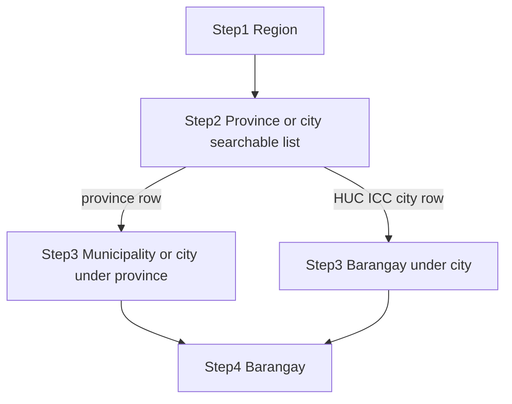

# SIBOL-ORG-IDENTITY-001 — Implementation plan (PLAN-002)

> **Handover ID:** SIBOL-ORG-IDENTITY-001-PLAN-002 (amended **PLAN-002-REFINE-001**)  
> **UUID:** `9e4c72b1-6a35-4f08-b2d9-81c573e0a624` · **Refine UUID:** `a7d41c82-9e35-4b60-8f21-c6a730e95d14`  
> **Parent:** SIBOL-INT-001  
> **Related:** SIBOL-OFFLINE-001 (dependency; not in scope to implement)  
> **Investigation:** [SIBOL_ORG_IDENTITY_001_INVESTIGATION_REPORT.md](SIBOL_ORG_IDENTITY_001_INVESTIGATION_REPORT.md) (PLAN-001, UUID `c5e71a92-8d34-4b60-9f21-a7630e58c4bd`)  
> **Date:** 2026-10-25  
> **Mode:** Planning only — **STOP before implementation** (no code, rules, emulator reset, deploy, commit, or push under this handover)

---

## 1. Verified Git baseline

| Item | Value |
|------|--------|
| Repository | `/Users/edbecnel/Development/GitHub/SIBOL` |
| **HEAD** | `a2adc62e4817d27e00385f792e303adbcc835c04` (`a2adc62`) |
| Branch | `main` tracking `origin/main` (aligned) |
| Latest commit | `docs(int-001): record SEED-001 emulator demonstration provisioning` |
| Untracked (planning session) | `SIBOL_ORG_IDENTITY_001_INVESTIGATION_REPORT.md`, `SIBOL_ORG_IDENTITY_001_IMPLEMENTATION_PLAN.md`, `firestore-debug.log`, `shared/functions/firestore-debug.log` (do not stage logs) |

**Note:** Investigation report is **not yet committed**; treat workspace copy as authoritative until PA publishes via separate commit handover.

---

## 2. Approved decision confirmation (D-01 – D-13)

| ID | PO/PA disposition | Planning implication |
|----|-------------------|---------------------|
| **D-01** | Approve ADR-REG-003 technical direction | Prepare **ADR acceptance package**; do not set ADR status to Accepted without EDF approval workflow |
| **D-02** | Uniqueness on **PSGC Barangay code**; not on display name | Identity key `barangay:PSGC:{code}`; duplicate homonym names allowed |
| **D-03** | Versioned PSGC; **offline-capable** in Flutter; no ordinary selection on live external API | Bundled reference + manifest; server validates against same version family |
| **D-04** | Record `psgcVersion` at registration; controlled updates; **no silent rewrite** of historical `orgId` refs | Org stores pinned version; label refresh jobs; migration callables for code supersession |
| **D-05** | NHFR required for normal hospital onboarding; separate internal `orgId` | Identity key `hospital:NHFR:{normalizedCode}` |
| **D-06** | Versioned NHFR snapshot; searchable selection; backend validation; **no continuous public API dependency** | Ops task: acquisition/licensing before build; bundle + manifest like PSGC |
| **D-07** | **Hospitals only**; RHUs out of scope unless new authorization | Filter NHFR snapshot to hospital facility types only |
| **D-08** | No silent teen barangay change via re-register; **future** audited callable | Fix register idempotency to **reject** different PSGC; defer change workflow to separate contract |
| **D-09** | Teen uses geo UI; backend resolves **PSGC → active org**; no teen-managed `orgId` | New callable input `selectedBarangayPsgcCode`; server sets `selectedBarangayOrgId` |
| **D-10** | **Defer** directory access policy | Document review in security section; **no change** to `regListBarangayDirectory` auth in first implementation slice without PA approval |
| **D-11** | Duplicate display names permitted; distinguish via official identity + geography | UI subtitles; admin summaries |
| **D-12** | Dedicated **`organizationIdentityKeys`**; atomic create; **client writes denied** | Firestore rules `false` on collection; transactional create |
| **D-13** | Keep **synthetic** `barangay03` / `hospital01` for INT-001 E2E; **no emulator reset**; production must not use synthetic exemption for real PSGC/NHFR | `identityKeyKind: synthetic_demo` only when emulator flag / explicit demo mode |

---

## 3. Philippine geographic hierarchy (SIBOL-ORG-GEO-001)

> **PLAN-002-REFINE-001 — F-01:** Replaces region-level “has province children?” branching.

### 3.1 Authoritative data model (dataset-driven)

- Store PSGC as a **directed graph**: each node has `code`, `level` (region | province | city_mun | barangay), `parentCode` (nullable only for region roots), and `officialName`.
- **No hardcoded city names or regional exceptions.** Mixed-path behavior emerges only from edges in the pinned bundle version.
- Backend validation **walks parent pointers** from selected barangay (or city/mun) to region; does not trust UI step labels.

### 3.2 Preferred UI model — “LGU parent” combined step (justification)

**Problem:** A single region may contain **both** province-governed municipalities **and** HUC/ICC cities that are **not** under any province. A region-wide “skip province if no provinces” rule is **wrong** for mixed regions.

**Chosen design:** After **Region**, present one searchable step:

**“Province or city (HUC/ICC)”** — a **combined, searchable list** of all **immediate LGU parents** under the selected region that can start a valid path to a barangay:

| Row source (from bundle) | User sees | Next step |
|--------------------------|-----------|-----------|
| `level == province` and `parentCode == region` | Province name (subtitle: “Province”) | **Municipality/City** children of that province |
| `level == city_mun` and `parentCode == region` and `cityClass` ∈ {HUC, ICC, …} per bundle metadata | City name (subtitle: “City”) | **Barangay** children of that city (province omitted) |

Then:

- **Path A (province-based):** Region → Province → Municipality/City → Barangay.
- **Path B (direct city):** Region → City (HUC/ICC) → Barangay.

**Why not a separate “jurisdiction type” toggle?** It forces users to know administrative class. The combined list keeps one mental model (“pick where you are”) while dataset metadata drives subtitles and the next step.

**Alternative rejected:** Region-level boolean “has provinces” — fails mixed regions (F-01).



### 3.3 Stored codes (all organizations using geography)

| Field | Description |
|-------|-------------|
| `psgcVersion` | Reference bundle version id (e.g. `Q2_2024`) |
| `psgcRegionCode` | Official region code |
| `psgcProvinceCode` | Official province code; **omit or null** when not applicable (HUC path) |
| `psgcCityMunCode` | Official city/municipality code |
| `psgcBarangayCode` | Required for **barangay org**; optional for hospital address precision |

Denormalized display names (`psgcRegionName`, etc.) are **derived from reference data** at write time and may be refreshed on version upgrade without changing codes.

### 3.4 UI behavior (Flutter)

1. Steps: Region → combined Province/city → (conditional) Municipality/City → Barangay; **reset all downstream** on any upstream change.
2. Searchable dropdowns at each step (type-ahead on official names + subtitles).
3. No free-text geography on create/register.
4. Offline: bundled reference DB only (§7, §11.1).
5. **Tests (required):** mixed-path **fixture region** with both a province branch and a direct HUC city branch; full four-level province path; HUC two-level-to-barangay path; invalid parent-child rejected server-side. **No hardcoded geographic names in test assertions** — use fixture codes only.

---

## 4. Identity reservation refinement (APPROVED)

### 4.1 Policy

- Uniqueness of **business identity** (PSGC barangay code or NHFR facility code) is enforced by **`organizationIdentityKeys`** document existence, **independent of** `organizations.status`.
- States **pending**, **active**, and **suspended** all **reserve** the key.
- **Suspension does not release** the key.
- **Deletion** (if ever allowed) does not auto-release; **release** only via separately authorized **audited admin migration** callable (out of initial slice unless PA scopes it).

### 4.2 Identity key document (initial implementation — F-07)

> **PLAN-002-REFINE-001 — F-07:** Permanent reservation only; no release/reuse fields in v1 schema.

**Collection:** `organizationIdentityKeys/{identityKey}`  
**Document id examples:** `barangay:PSGC:0128101001`, `hospital:NHFR:123456789012345678`, `synthetic:demo:barangay03`

| Field | Purpose |
|-------|---------|
| `identityKey` | Same as document id (immutable) |
| `identityKind` | `barangay_psgc` \| `hospital_nhfr` \| `synthetic_demo` |
| `businessCode` | PSGC barangay code or normalized NHFR code; synthetic token for demo |
| `orgId` | Owning organization (immutable) |
| `referenceVersion` | `psgcVersion` or `nhfrSnapshotVersion` at reservation |
| `reservedAt` | Server timestamp |
| `createdByUid` | Central Admin uid (audit) |

**Semantics:**

| Term | Meaning in v1 |
|------|----------------|
| **Reserved key** | Document exists; `tx.create` on same id → `already-exists` |
| **Released key** | **Not supported** — deferred to R-06 separate work item |
| **Historical record** | Identity key + `auditEvents` + org doc; never deleted in v1 |
| **Reusable key** | **Never** in v1 — administrative correction is future scope |

Suspension does **not** delete or release keys. Existing key documents always produce **deterministic duplicate rejection** on recreate.

**Teen routing:** See §9 — resolve via identity key, then require `organizations.status == active`. Suspended org → **failed-precondition**; key remains reserved.

### 4.3 Transactional create (single Firestore transaction)

1. Validate geography and/or NHFR row against server-held snapshot for declared version.
2. `tx.get(identityKeyRef)` — if exists → `already-exists` (regardless of org `status`).
3. `tx.create(identityKeyRef, …)`.
4. `tx.create(organizations/{orgId}, …)` including `orgId` field **equal to** doc id.
5. `tx.create(invitation, …)`.
6. On `orgId` collision (extremely rare): abort entire transaction; optional single retry with new `generateOrgId()` **outside** partial state (no identity key without org).

**Concurrent duplicate registration:** Two transactions on same `identityKey` → one succeeds, one `already-exists`.

**Partial failure:** Never commit identity key without org in the same transaction.

### 4.4 Administrative recovery (R-06 DEFER)

- Identity release, reassignment, and correction → **separate audited migration work item**; **no release callable** in SIBOL-ORG-IDENTITY-001.
- Historical `cases.orgId`, memberships, teen `selectedBarangayOrgId` remain unchanged unless explicit data migration authorized.

### 4.5 Organization creation idempotency (F-04)

**Applies to:** `regCreateBarangayOrganization`, `regCreateHospitalOrganization`.

| Aspect | Specification |
|--------|----------------|
| **Required?** | **Yes** — `idempotencyKey` mandatory (UUID v4) on every create request |
| **Generation** | Client generates once per user-initiated submit; reuse same key on retry after timeout |
| **Scope** | Per Central Administrator uid + operation + `idempotencyKey` |
| **Storage** | `organizationCreationIdempotency/{centralAdminUid}__{idempotencyKey}` (server-only writes) |
| **Record fields** | `status` (`in_progress` \| `completed` \| `failed`), `requestFingerprint` (stable hash of canonical request body), `response` (orgId, invitationId, …), `createdAt`, `completedAt`, `expiresAt` (e.g. 30 days TTL for GC) |
| **Atomicity** | Single transaction: idempotency claim → identity key → org → invitation → idempotency `completed` + response snapshot |
| **Retry, same key + same fingerprint** | Return **stored response** (HTTP/callable success; no duplicate org or invitation) |
| **Retry, same key + different fingerprint** | `failed-precondition` (“idempotency key reused with different payload”) |
| **Concurrent duplicate keys** | One transaction wins `create` on idempotency doc; other fails or reads completed state |
| **Lost response after success** | Client retries with same key → cached response; operator sees same `orgId` / `invitationId` |
| **Partial failure** | Transaction rolls back; idempotency not `completed`; safe retry |
| **Invitation duplication** | Invitation created only inside same transaction as org; idempotent retry must not create second invitation |

**Client recovery UX:** Show “Checking registration status…” on retry; never assume failure until idempotent response or definitive error.

**Tests:** timeout retry; concurrent duplicate submit; fingerprint mismatch; verify single invitation document.

---

## 5. Barangay registration contract (implementation-ready proposal)

**Callable:** `regCreateBarangayOrganization` (evolution of `regCreateOrganization`; versioned contract — see EDF §16).

### 5.1 Request fields (Central Administrator)

| Name | Type | Req | Default | Validation | Authoritative source | UI label | Editable after create | Uniqueness | Storage | Offline |
|------|------|-----|---------|------------|----------------------|----------|----------------------|------------|---------|---------|
| `psgcVersion` | string | Y | app bundled latest | Must match server-accepted manifest | Client bundle manifest; **server verifies** | (read-only) Reference data version | No | No | `organizations.psgcVersion` | Y (read) |
| `psgcRegionCode` | string | Y | — | Exists in bundle; root of chain | PSGC bundle | Region | No | No | `organizations.psgcRegionCode` | Y |
| `psgcProvinceCode` | string | N* | null | *Required iff province step applicable; must be child of region | PSGC bundle | Province | No | No | `organizations.psgcProvinceCode` | Y |
| `psgcCityMunCode` | string | Y | — | Child of province OR direct child of region per bundle | PSGC bundle | City / Municipality | No | No | `organizations.psgcCityMunCode` | Y |
| `psgcBarangayCode` | string | Y | — | Child of city/mun; official barangay | PSGC bundle | Barangay | No | **Yes** (identity key) | `organizations.psgcBarangayCode` + identity key | Y |
| `displayNameAlias` | string | N | null | 1–200 chars; must not replace official name in identity UI | Central Admin optional (**R-04**) | Display alias (optional) | Yes (display only) | No | `organizations.displayNameAlias` | Y (draft) |
| `officialBarangayName` | string | Y (server) | from PSGC at create | must match `psgcBarangayCode` in bundle | PSGC bundle | Official barangay name (read-only) | Refresh labels only | No | `organizations.officialBarangayName` | Y (read) |
| `legacyBarangayLabel` | string | N | null | migration string | Central Admin | Legacy label (migration) | Yes | No | `organizations.legacyBarangayLabel` | Y (draft) |
| `initialOrgAdminEmail` | string | Y | — | normalize + hash | Central Admin input | Initial org administrator email | N/A (invitation) | Per-org pending invite | invitation doc | N (needs network) |
| `idempotencyKey` | string | Y | — | UUID v4 | Client per submit | — | — | — | `organizationCreationIdempotency` | Y (reuse on retry) |

### 5.2 Server-only response / stored fields

| Name | Type | Req | Default | Validation | Source | UI label | Editable | Uniqueness | Storage | Offline |
|------|------|-----|---------|------------|--------|----------|----------|------------|---------|---------|
| `orgId` | string | Y | `generateOrgId()` | `isValidOrgId`; == doc id | Server | Internal (admin detail only) | No | Global | `organizations/{orgId}` | N until success |
| `type` | string | Y | `barangay` | enum | Server | — | No | — | organizations | N |
| `status` | string | Y | `active` | enum | Server | Status | Central Admin status callable | No | organizations | N |
| `psgc*Name` denorm | strings | Y | from PSGC | — | Server at create | Geographic summary | Refresh job | No | organizations | Y (read) |
| `createdAt` / `updatedAt` | timestamp | Y | server | — | Server | — | No | — | organizations | N |

**Presentation vs identity (R-04, D-11):** `psgcBarangayCode` + identity key = **official identity**; `officialBarangayName` + geographic context always shown where ambiguity matters; optional `displayNameAlias` maps to `organizations.name` for lists if set, else official name.

---

## 6. Hospital registration contract (implementation-ready proposal)

**Callable:** `regCreateHospitalOrganization`

### 6.1 Request fields (Central Administrator)

| Name | Type | Req | Default | Validation | Authoritative source | UI label | Editable after create | Uniqueness | Storage | Offline |
|------|------|-----|---------|------------|----------------------|----------|----------------------|------------|---------|---------|
| `nhfrSnapshotVersion` | string | Y | bundled latest | Server manifest | NHFR snapshot manifest | Facility list version | No | No | organizations + key | Y (read) |
| `nhfrFacilityCode` | string | Y | — | Normalized 18-digit (or PH Core rules); row exists in snapshot; **hospital type only** (D-07) | NHFR snapshot | Facility (official) | No | **Yes** (identity key) | organizations + identity key | Y (search local index) |
| `psgcVersion` | string | Y | bundled latest | Server manifest | PSGC bundle | Geographic data version | No | No | organizations | Y |
| `psgcRegionCode` | string | Y | — | hierarchy | PSGC | Region | No | No | organizations | Y |
| `psgcProvinceCode` | string | N* | null | HUC exception | PSGC | Province | No | No | organizations | Y |
| `psgcCityMunCode` | string | Y | — | must match facility row city/mun when NHFR provides it | PSGC + NHFR cross-check | City / Municipality | No | No | organizations | Y |
| `psgcBarangayCode` | string | N | null | optional child of city/mun | PSGC | Barangay (optional) | No | No | organizations | Y |
| `addressLine1` | string | N | from NHFR | max length | NHFR suggest + admin edit | Address line 1 | Yes | No | organizations | Y (draft) |
| `addressLine2` | string | N | null | max length | Admin | Address line 2 | Yes | No | organizations | Y (draft) |
| `displayName` | string | Y | `facilityOfficialName` | 1–200 | Server default NHFR name | Display name | Yes (display) | No | `organizations.name` | Y (draft) |
| `initialOrgAdminEmail` | string | Y | — | email | Admin | Initial org administrator email | — | invite uniqueness | invitation | N |
| `idempotencyKey` | string | Y | — | UUID v4 | Client per submit | — | — | — | `organizationCreationIdempotency` | Y (reuse on retry) |

### 6.2 Server-derived official fields

| Name | Type | Source | Storage |
|------|------|--------|---------|
| `facilityOfficialName` | string | NHFR row | organizations |
| `orgId` | string | Server | organizations + identity key |
| `type` | `hospital` | Server | organizations |

---

## 7. Geographic reference-data design (PSGC)

### 7.1 Acquisition (Workstream B — pre-implementation gate)

| Task | Owner | Output |
|------|-------|--------|
| Confirm PSA **license/terms** for bundling in mobile app | PO/Ops | Written allowance or attribution requirements |
| Select pinned version (e.g. `Q2_2024`) | PA | Manifest id |
| Download masterlist / API export | Engineering | Raw source archive (not committed if license restricts — document process) |
| Normalize to **adjacency list** + indexes | `shared/geo-reference/` | `build.mjs` → versioned artifact |

**EXTERNAL assumption:** Barangay PSGC codes are nationally unique within a version.

### 7.2 Artifact structure (proposed)

```
shared/geo-reference/
  manifests/psgc-{version}.json    # version, sha256, generatedAt, minAppBundleId
  artifacts/psgc-{version}.sqlite  # or compressed JSON chunks
```

**Tables / indexes:** `regions`, `provinces`, `city_muns`, `barangays`, `parent_child (parentCode, childCode, level)`.

**Flutter:** ship `assets/geo/psgc-{version}.sqlite` (or drift DB populated on first launch from asset); **same version string** as Functions validator.

### 7.3 Server validation

- Functions load artifact from deployment package or Cloud Storage pinned object (same sha256 as manifest).
- Reject create if any code unknown or parent chain invalid.
- **No runtime PSA API** for ordinary registration (D-03).

### 7.4 Updates (D-04)

- New manifest version published; app receives optional delta via future OFFLINE-001 sync or **app update** (distinct from reference-only refresh).
- Organizations keep `psgcVersion` frozen; **display name refresh** job may read newer bundle for labels only.

### 7.5 Supported reference-version policy (F-05)

| Concern | Policy |
|---------|--------|
| **Bundled version** | App ships ≥1 PSGC artifact versions listed in `pubspec`/manifest; user selection tagged with `psgcVersion` used offline |
| **Server supported set** | Callable `regGetReferenceManifest` (or static config) returns `supportedPsgcVersions[]`, `recommendedPsgcVersion`, `minSupportedAppBuild` (optional) |
| **Integrity** | Manifest includes `sha256` per artifact; app verifies on load; server verifies deployment package hash |
| **New classifications** | New PSA release → new version id added to supported set after QA; **does not** auto-remap existing org codes |
| **Superseded codes** | Codes absent from the **submitted** version snapshot → `invalid-argument`; server **never** silently maps code A → code B |
| **Offline selection, older supported bundle** | Allowed while version ∈ `supportedPsgcVersions`; submit validates against server copy of **that** version |
| **Submit after connectivity returns** | Same rules; if version revoked → `failed-precondition` with user message to update app (**app update**, not silent data rewrite) |
| **Unsupported / revoked version** | Reject with explicit recovery: install app update or sync reference bundle when OFFLINE-001 provides it |
| **NHFR** | Parallel `supportedNhfrSnapshotVersions[]`; same rules for hospital create |

**User-facing copy distinction:** “Update SIBOL app” (software) vs “Reference data updated” (manifest banner) — do not conflate.

---

## 8. NHFR reference-data design

### 8.1 Acquisition gate (F-06 — blocking for real hospital registration)

**Status:** NHFR redistributability is **not established**. Do not assume production hospital onboarding until gate **G-NHFR** closes.

| Gate item | Required evidence |
|-----------|-------------------|
| **Authoritative source** | DOH NHFR portal / published bulk export (EXTERNAL); document exact URL and retrieval date |
| **Format & access** | CSV/Excel/API; automation feasibility; rate limits |
| **Facility code** | Normalization rules (18-digit, leading zeros, PH Core `doh-nhfr-code` system URI) |
| **Hospital classification** | Field(s) distinguishing hospital vs RHU vs others (D-07 filter definition) |
| **Geographic linkage** | PSGC city/mun codes in dump; completeness metrics |
| **License / redistribution** | Written PO/legal determination (**R-05**): may generated artifacts be committed? |
| **Provenance & versioning** | `nhfrSnapshotVersion`, source file hash, build timestamp |
| **Completeness validation** | Row counts, required columns, duplicate facility codes |
| **If blocked** | Mark **G-NHFR OPEN**; no production `regCreateHospitalOrganization` with real NHFR; synthetic fixtures only |

**Engineering track A (may proceed without final NHFR):** schemas, `CONTRACT-NHFR-001` draft, validator interfaces, **synthetic** `nhfr-test-fixture` SQLite (clearly labeled `synthetic_test_only`), hospital create **unit tests** against fixture.

**Engineering track B (waits on G-NHFR):** production snapshot build, committed artifacts (if R-05 allows), real facility picker data, production hospital registration enablement.

### 8.2 Pre-implementation investigation checklist (D-06)

| Question | Action |
|----------|--------|
| License/redistribution of NHFR bulk CSV? | PO/legal review of DOH terms — **G-NHFR** |
| Update frequency | Ops calendar (e.g. quarterly manual import) |
| Hospital type filter | Define allowed `facilityType` values in snapshot spec |
| Validation limits | NHFR may lack per-code live API — **snapshot-only validation** (EXTERNAL) |
| PHI in dump | Strip fields not needed for selection |

### 8.3 Artifact structure (proposed)

```
shared/facility-reference/
  manifests/nhfr-{version}.json
  artifacts/nhfr-{version}.sqlite
```

**Indexes:** `nhfrFacilityCode`, `officialName` (search), `psgcCityMunCode`, `facilityType`.

### 8.4 UI

- Searchable list filtered by selected city/mun (and region/province path).
- Offline search against local snapshot (D-03/D-06).

---

## 9. Teen selection and backend resolution (F-02, D-08, D-09, R-03)

> **PLAN-002-REFINE-001 — F-02:** Identity-key registry is **authoritative** for business identity; organizations collection is loaded **after** key resolution.

### 9.1 Primary contract (production and post-transition)

**`regRegisterTeenAccount` input:**

| Field | Type | Req | Notes |
|-------|------|-----|-------|
| `selectedBarangayPsgcCode` | string | Y | From geo UI only; never `orgId` |
| `psgcVersion` | string | Y | Must be ∈ server `supportedPsgcVersions` (§7.5) |
| `displayName` | string | N | unchanged |
| `privacyConsentAcknowledged` | bool | Y | unchanged |

**Deterministic server resolution (ordered):**

1. **Validate** `selectedBarangayPsgcCode` syntax and presence in server snapshot for `psgcVersion` (full parent chain to region).
2. **Construct** `identityKey = barangay:PSGC:{selectedBarangayPsgcCode}` (canonical formatting).
3. **Read** `organizationIdentityKeys/{identityKey}`.
4. **If missing** → `not-found` (“This Barangay is not registered in SIBOL yet”).
5. **Resolve** `orgId` from identity-key document.
6. **Load** `organizations/{orgId}`.
7. **Verify** document exists.
8. **Verify** `type == barangay`.
9. **Verify** `organization.psgcBarangayCode == selectedBarangayPsgcCode` (consistency guard).
10. **Verify** `status == active` — if `pending` or `suspended` → `failed-precondition` (“Barangay not available for assistance routing”); key remains reserved.
11. **Bind** teen: set `users.selectedBarangayOrgId = orgId` only after steps 1–10 pass.

**Error matrix:**

| Condition | Code | Notes |
|-----------|------|-------|
| Unknown / invalid PSGC for version | `invalid-argument` | Stale bundle (F-05) |
| Unsupported `psgcVersion` | `failed-precondition` | App update / manifest |
| No identity key | `not-found` | No SIBOL org for that barangay |
| Key exists, org missing | `failed-precondition` | Data integrity — alert ops |
| Key `orgId` mismatch org doc | `failed-precondition` | Inconsistent ownership |
| PSGC mismatch org field | `failed-precondition` | Tamper / corruption |
| Org suspended / pending | `failed-precondition` | Not active for routing |
| `identityKind == synthetic_demo` in production | `permission-denied` | Emulator-only (§10) |
| Teen exists, same PSGC / same org | success idempotent | |
| Teen exists, different PSGC | `failed-precondition` | D-08 / R-02 — no silent change |

**Authorization:** `orgId` is never accepted from client on this path in production. Case routing continues to use immutable `selectedBarangayOrgId` once set.

### 9.2 Temporary compatibility (R-03 — first connected INT-001 E2E only)

**Purpose:** Preserve seeded teen/staff flows on `barangay03` without masquerading demo org as a real PSGC barangay in the geographic picker.

| Mechanism | Rule |
|-----------|------|
| **Seeded teen** | Existing profile keeps `selectedBarangayOrgId: barangay03`; sign-in + assistance **unchanged** — no re-registration |
| **Geographic UI** | Does **not** list `barangay03` as a verified PSGC choice; demo org has **no** `barangay:PSGC:*` production key |
| **Legacy callable input** | `selectedBarangayOrgId` accepted **only when** `SIBOL_ALLOW_LEGACY_TEEN_ORG_BINDING=true` (Functions emulator / CI) **and** target org has `identityKind: synthetic_demo` on its synthetic key **and** orgId ∈ `{ barangay03 }` allowlist |
| **Production** | Legacy `orgId` input **rejected** (`invalid-argument`) |
| **Removal gate** | After INT-001 E2E sign-off + one milestone buffer; documented in CONTRACT-REG-C v2 |

**New teen during E2E:** Uses PSGC UI → selects barangay where Central Admin created a **real-code** org (scenario §10.4); or test script uses legacy path only in emulator for explicit regression rows.

### 9.3 Directory callable (R-01 DEFER)

No auth change to `regListBarangayDirectory` in this tranche. Record **SEC-REVIEW-001**: enumeration, abuse, privacy, rate limits. Teen primary flow uses geo + identity resolution, not flat directory.

**UI:** Cascading geo pickers (§3); confirmation shows official barangay name + municipality/province/region context — never `orgId`.

---

## 10. Emulator / synthetic compatibility (F-03, D-13, R-03)

**Constraints:** No emulator reset/reseed/migration during ORG-IDENTITY work. No production bypass of PSGC/NHFR validation. Synthetic demo must not appear as a verified real PSGC barangay in geo UI.

| Org | VERIFIED id | Identity key (additive, emulator/backfill) |
|-----|-------------|---------------------------------------------|
| Demo Barangay | `barangay03` | `organizationIdentityKeys/synthetic:demo:barangay03` — `identityKind: synthetic_demo` |
| Demo Hospital | `hospital01` | `organizationIdentityKeys/synthetic:demo:hospital01` |

**Environment boundary:** `SIBOL_ALLOW_DEMO_IDENTITY` / `SIBOL_ALLOW_LEGACY_TEEN_ORG_BINDING` — **emulator and CI only**; hard-fail in production deploy config.

### 10.1 Scenario behaviors (first connected E2E)

| # | Scenario | Expected behavior |
|---|----------|-------------------|
| 1 | **Seeded teen** signs in (`barangay03` binding already on profile) | No geo re-registration; assistance routes via existing `selectedBarangayOrgId`; rules unchanged |
| 2 | **Seeded barangay / hospital staff** | Memberships on `barangay03` / `hospital01` unchanged; case/coordination flows work |
| 3 | **New teen** registers during E2E | Geographic UI + PSGC resolution (§9); **or** emulator legacy shim (§9.2) for scripted rows — not both ambiguous in same test without labeling |
| 4 | **Central Admin** creates **real** barangay | New `barangay:PSGC:{code}` key + org; does not alter demo org |
| 5 | **Central Admin** creates **real** hospital | Requires **G-NHFR** closed; else blocked in prod; emulator may use synthetic NHFR fixture for engineering tests only |
| 6 | **New teen** picks barangay in geo UI | Only PSGC codes with registered SIBOL org resolve (step 9); selecting unregistered official barangay → `not-found`; **cannot** select demo synthetic as real PSGC |

**Distinguish users:** Seeded accounts = pre-existing `users` docs from seed; new teens = post-implementation registration contract.

**Tests:** Emulator integration row for each scenario; assert production config rejects synthetic key registration and legacy `orgId` teen binding.

### 10.2 Legacy create callable

`runCreateOrganization` (free-text name) remains until INT-001 E2E passes; new PSGC callables additive. Deprecation gate tied to M4 sign-off.

---

## 11. Offline terminology and boundaries (F-08, SIBOL-OFFLINE-001)

### 11.1 In scope for SIBOL-ORG-IDENTITY-001 — offline **reference data**

| Capability | In scope? |
|------------|-----------|
| PSGC cascading geographic selection from **bundled** artifact | **Yes** |
| NHFR facility search from **approved local** snapshot (when G-NHFR permits) | **Yes** |
| Manifest / `sha256` integrity check on load | **Yes** |

### 11.2 Out of scope — offline **workflow** (SIBOL-OFFLINE-001)

| Capability | Status in this work item |
|------------|--------------------------|
| Draft store for org-create forms | **Not implemented** — do not document as existing |
| Sync queue / retry scheduler | **Not implemented** |
| “Pending registration” persisted across app restarts | **Deferred** to OFFLINE-001 |

**Truthfulness rules (current work):**

| Operation | Offline | User messaging |
|-----------|---------|----------------|
| Geographic selection | Works | Local UI state only |
| Org create submit | **Requires connectivity** | Failure if offline; no success UI without server ack |
| Teen Firebase Auth + callable register | **Requires connectivity** | Local form fields may be filled; completion ≠ registered |
| Uniqueness | Server authoritative | — |

**Future-friendly interfaces (design only):** org-create and teen-register screens expose explicit `SubmissionState { idle, submitting, succeeded, failed }` and idempotency key holder — **no queue persistence** until OFFLINE-001.

**Approved PO sequence (unchanged):** contracts → geo + uniqueness → connected INT-001 E2E on synthetic seed → **prioritize OFFLINE-001** → intermittent connectivity verification → later bootstrap rehearsal / demo reset (**not** during ORG-IDENTITY).

Reference: [ADR-0004](../Architecture/ADRs/ADR-0004-Offline-Sync-and-Common-Core-Boundaries.md).

---

## 12. Phased implementation workstreams and milestones

> **PLAN-002-REFINE-001:** M0/M1 split documentation vs executable engineering; per-milestone PA checkpoint; Git commit/push at milestone completion (separate from Firebase deploy).

### Milestone 0 — EDF and reference-data readiness (documentation & gates only)

**Inputs:** Approved PLAN-002 + REFINE-001; investigation report; git `a2adc62` baseline.

**Deliverables:**

- Draft ADR-REG-003 acceptance package (D-01) — **status unchanged** until PA accepts.
- Draft ADR-REG-004, SPEC-REG-001 amendment, CONTRACT-REG-001 v2, CONTRACT-REG-C v2 (incl. R-03 shim), CONTRACT-GEO-001, CONTRACT-NHFR-001, schemas (identity key v1 without release fields).
- PSGC source selection + PSA redistribution evidence (**R-05**).
- NHFR acquisition assessment + **G-NHFR** register (F-06).
- MVR-ORG-IDENTITY-001 draft test plan (incl. F-01 mixed-path, F-04 idempotency).
- SEC-REVIEW-001 ticket text (R-01).
- Explicit blocker list: `G-NHFR`, any PSA license gap.

**Acceptance tests:** Document review checklist; no runtime tests.

**Security/licensing gates:** PO sign-off on PSGC commit policy; NHFR legal memo started.

**EDF evidence:** Draft files in repo paths §15 — **not** marked normative/effective.

**PA checkpoint:** Approve **AGENT-001** scope (M1 only) and M0 draft quality.

**Out of scope for M0:** Functions, Flutter, emulator changes, dataset download into repo (unless R-05 pre-approved).

---

### Milestone 1 — Reference-data engineering (executable, post-M0 PA gate)

**Inputs:** Closed M0 PA checkpoint; PSGC acquisition authorized.

**Deliverables:**

- Reproducible PSGC normalization pipeline (`shared/geo-reference/`).
- Offline bundle + manifest + integrity hash; **mixed-path fixture region** (F-01).
- Shared validation library (parent-walk, version-aware).
- Backend validator interfaces (no org-create callables yet).
- NHFR: **Track A only** if G-NHFR open — synthetic fixture + schema validators; **no** production NHFR artifact commit.
- Automated tests: hierarchy, mixed paths, version policy unit tests (F-05 logic).

**Acceptance tests:** `shared/geo-reference` npm test green; validator rejects invalid chains; fixture covers province path + HUC path in same region.

**Security/licensing gates:** Committed artifacts only if R-05 allows; otherwise CI fetch from secure store documented.

**EDF evidence:** Execution report; reproducible build instructions.

**PA checkpoint:** M1 complete → authorize M2 handover.

**Explicitly excluded from M1:** `organizationIdentityKeys` implementation, `regCreateBarangayOrganization`, Flutter screens, emulator seed changes.

---

### Milestone 2 — Backend identity (Workstream C)

- `organizationIdentityKeys` collection + rules deny client writes.
- Transactional barangay + hospital create callables.
- Identity reservation tests (suspended org still blocks duplicate).
- Concurrent create tests.
- Teen PSGC resolution + different-code rejection.
- **Exit:** Functions + rules tests green; no Flutter change required for CI.

### Milestone 3 — Flutter registration UI (Workstream D)

- Shared cascading geo widget (searchable).
- Central Admin barangay + hospital create screens.
- Teen registration geo flow (D-09).
- Human-readable org presentation (admin list/detail).
- **Exit:** Widget tests + emulator manual path (new org creation); **INT-001 synthetic E2E unchanged**.

### Milestone 4 — INT-001 connected E2E

- Run scenarios A–F with **existing** seed (D-13).
- **Exit:** MVR-INT-001 updated rows PASS.

### Milestone 5 — Handoff to SIBOL-OFFLINE-001

- Document draft queue for org create; defer full sync.

**Rollback:** Feature flags `usePsgcOrgRegistration`; legacy callables until M4 complete.

---

## 13. Security and migration risks

| Risk | Mitigation |
|------|------------|
| Identity key / org partial write | Single transaction (§4.3) |
| Client forges PSGC/NHFR | Server-only validation against manifest |
| Teen sends forged `orgId` | Remove from contract (D-09) |
| Enumeration via directory (D-10) | Deferred; teen uses geo not full list |
| Synthetic demo keys in production | Environment guard on `identityKind` |
| `orgId` field ≠ doc id | Assert on write; repair migration |
| PSGC version skew app vs server | Supported-version policy §7.5; revoked → app update message |
| NHFR stale data | Display snapshot version; ops refresh process |
| Historical cases on suspended org | `orgId` stable; teen cannot select suspended |
| Concurrent duplicate real barangay | Identity key transaction |

---

## 14. Verification strategy (Workstream E)

**New matrix:** `MVR-ORG-IDENTITY-001` (proposed)

| Case | Type |
|------|------|
| Create barangay with valid PSGC | Positive |
| Duplicate PSGC (active org) | `already-exists` |
| Duplicate PSGC (suspended org) | `already-exists` (reservation) |
| Same display name, different PSGC | Both succeed |
| HUC path without province | Positive |
| Invalid parent-child chain | `invalid-argument` |
| Concurrent duplicate create | One success, one `already-exists` |
| Hospital duplicate NHFR | `already-exists` |
| Invalid NHFR / wrong type (RHU) | Rejected |
| Teen resolve via identity key → active org | Positive |
| Teen identity-key missing | `not-found` |
| Teen org suspended with reserved key | `failed-precondition` |
| Org create idempotency retry | Single org + invitation |
| Mixed-path region fixture | UI + validator |
| Teen re-register different PSGC | **Rejected** (not silent) |
| Teen PSGC with no SIBOL org | `not-found` |
| Offline geo widgets load bundled data | Flutter test |
| Demo `barangay03` still routes INT-001 | Regression |
| Rules: client cannot write identity keys | Rules test |
| Security: org-scoped case access unchanged | Regression rules |

**Gates:** All `shared/functions`, `shared/firestore-rules-test`, `shared/reg`, `sibol_app` tests green per milestone.

---

## 15. EDF documents — publication or amendment required

| Document | Action | Authorization needed |
|----------|--------|----------------------|
| [ADR-REG-003](../Architecture/ADRs/ADR-REG-003-Organization-Identifier-Policy.md) | Status → **Accepted** (proposal package) | PA EDF acceptance (D-01) |
| **ADR-REG-004** (proposed) | Organization geographic & facility identity | PA new ADR |
| [ADR-REG-001](../Architecture/ADRs/ADR-REG-001-Organization-Identity-and-Membership.md) | Cross-reference PSGC/NHFR keys | Amendment |
| [SPEC-REG-001](../Specifications/SPEC-REG-001-Registration-and-Organization-Authorization.md) | §5 org fields, uniqueness, lifecycle | Draft amendment |
| [CONTRACT-REG-001](../../shared/docs/CONTRACT-REG-001-Registration-and-Administration-Services.md) | Split/create barangay & hospital callables | Draft |
| [CONTRACT-REG-C](../../shared/docs/CONTRACT-REG-C-Teen-Registration.md) | PSGC resolution input | Draft |
| **CONTRACT-GEO-001** (new) | PSGC bundle manifest, hierarchy, HUC | Draft |
| **CONTRACT-NHFR-001** (new) | Snapshot, hospital filter, validation | Draft |
| [organization.schema.json](../../shared/contracts/organization.schema.json) | PSGC/NHFR fields | Draft |
| **organization_identity_key.schema.json** (new) | Identity registry | Draft |
| [MVR-INT-001](../Verification/Records/MVR-INT-001-End-to-End-Verification-Matrix.md) | Demo regression rows | Update after M4 |
| **MVR-ORG-IDENTITY-001** (new) | §14 | Draft |
| [WORK_ITEM_REGISTER.md](WORK_ITEM_REGISTER.md) | SIBOL-ORG-IDENTITY-001 impl; SIBOL-OFFLINE-001 | PA |
| Roadmap / CHANGELOG | Milestone ordering §11 | PA |

**Do not** mark specifications “effective for implementation” until PA issues **implementation AGENT handover** after this plan approval.

---

## 16. PA dispositions R-01 – R-07 (PLAN-002-REFINE-001)

| ID | Disposition | Plan incorporation |
|----|-------------|-------------------|
| **R-01** | **DEFER** directory auth | §9.3; SEC-REVIEW-001; no `regListBarangayDirectory` change this tranche |
| **R-02** | **DEFER** teen barangay change | §9.1 error on different PSGC; future work item only |
| **R-03** | **APPROVE** temporary legacy teen `orgId` shim | §9.2; emulator/CI only; removal gate post–INT-001 E2E |
| **R-04** | **APPROVE** optional display alias | §5.1 `displayNameAlias`; official name always visible |
| **R-05** | **CONDITIONAL** commit artifacts | §7.1, §8.1, M1 licensing gate |
| **R-06** | **DEFER** identity release | §4.2, §4.4; v1 schema without release fields |
| **R-07** | **APPROVE** active default | Create org `status: active`; schema retains `pending` for future policy |

### 16.1 Remaining PA/PO attention (unresolved)

| ID | Topic | Notes |
|----|-------|-------|
| PO-01 | **G-NHFR** closure | Blocks real hospital registration (§8.1) |
| PO-02 | PSA redistribution | Blocks committing PSGC artifacts (R-05) |
| PA-01 | ADR-REG-003 formal acceptance | Package in M0; status change requires EDF workflow |
| PA-02 | SEC-REVIEW-001 scheduling | R-01 follow-up |
| PA-03 | Legacy shim removal milestone | After M4 INT-001 E2E |

---

## 17. Recommended AGENT-001 scope (post–REFINE-001 PA approval)

**Handover ID:** `SIBOL-ORG-IDENTITY-001-AGENT-001`  
**Authorization (proposed):** **Milestone 0 only**, then **Milestone 1** after M0 PA checkpoint — not combined without explicit PA approval.

**M0 executable:** Draft EDF documents §15; G-NHFR assessment memo; PSGC source/redistribution evidence; MVR-ORG-IDENTITY-001 draft; SEC-REVIEW-001 text.

**M1 executable (after M0 gate):** `shared/geo-reference` pipeline, mixed-path fixture, validation library, tests; NHFR Track A synthetic fixture if G-NHFR open.

**Out of scope:** M2+ (identity keys, callables), Flutter, emulator touch, Firebase deploy, commit/push unless PA authorizes per-milestone Git publication in AGENT handover.

**Git:** AGENT handover should specify commit(s) at M0 and M1 completion separately; exclude debug logs.

---

## 18. Traceability

| Source | This plan |
|--------|-----------|
| PLAN-001 (`c5e71a92-…`) investigation | VERIFIED baseline; report unchanged |
| PLAN-002 (`9e4c72b1-…`) | D-01–D-13, M0–M5 |
| PLAN-002-REFINE-001 (`a7d41c82-…`) | F-01–F-08, R-01–R-07, §3 §4.5 §7.5 §8.1 §9–§12 |
| Git `a2adc62` | §1 |

---

## 19. PLAN-002-REFINE-001 — Refinement resolution matrix

| Ref | Section(s) | Resolution summary |
|-----|------------|-------------------|
| **F-01** | §3.1–§3.4 | Combined “Province or city” step; dataset parent-child graph; mixed-region tests |
| **F-02** | §9.1 | Ten-step identity-key–first resolution; error matrix |
| **F-03** | §10.1 | Six E2E scenarios; synthetic not in geo UI as real PSGC |
| **F-04** | §4.5 | Mandatory idempotency; durable record; transaction with org + invitation |
| **F-05** | §7.5 | Supported version set; no silent code translation |
| **F-06** | §8.1 | G-NHFR gate; Track A vs B |
| **F-07** | §4.2 | Permanent reservation schema; no release fields in v1 |
| **F-08** | §11 | Reference offline in scope; workflow sync out of scope |

---

**STOP — PLAN-002-REFINE-001 complete. Awaiting PA review before `SIBOL-ORG-IDENTITY-001-AGENT-001` implementation authorization.**
