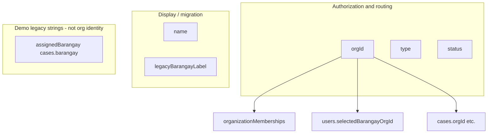

# SIBOL-ORG-IDENTITY-001 — Organization registration identity and uniqueness

> **Handover ID:** SIBOL-ORG-IDENTITY-001-PLAN-001 (refined)  
> **UUID:** `c5e71a92-8d34-4b60-9f21-a7630e58c4bd`  
> **Parent:** SIBOL-INT-001  
> **Date:** 2026-10-25  
> **Mode:** Read-only investigation — **no implementation, deploy, commit, or emulator data changes**  
> **Repository baseline:** workspace `main` at investigation time (REG-A/REG-B/REG-C + INT-001-AMEND-001 as documented in EDF)

## Executive summary

**Verified (code):** SIBOL organizations are identified for authorization and routing by opaque, server-assigned **`orgId`** (Firestore document id). Display **`name`** and optional **`legacyBarangayLabel`** are not uniqueness keys. Central Administrator creation uses `generateOrgId()`; clients cannot supply `orgId`. Teen registration binds `users.selectedBarangayOrgId` to an existing active `type: barangay` organization. No PSGC, NHFR, or cascading geographic fields exist in schema, callables, or Flutter registration UI.

**Proposed (PA requirements SIBOL-ORG-GEO-001 and refinements):** Production registration should use **PSGC official codes** with **Region → Province → Municipality/City → Barangay** cascading selection; Barangay org uniqueness should prefer **one active organization per official Barangay PSGC code**; Hospital orgs should anchor on **Municipality/City PSGC** plus **DOH NHFR (or equivalent) facility identity**, with backend-validated hierarchy and atomic uniqueness enforcement.

**Decision register (§12)** lists PA/PO choices required before an implementation handover.

---

## Evidence classification

| Tag | Meaning |
|-----|---------|
| **VERIFIED** | Observed in repository source, rules, contracts, or tests cited below |
| **ARCH** | Accepted or draft architecture in EDF (may not match code) |
| **PROPOSED** | Recommended target design; not implemented |
| **EXTERNAL** | Official Philippine reference systems; not integrated in SIBOL |

---

## 1. Normative vs implemented delta

| Topic | ARCH / contract | VERIFIED implementation |
|-------|-----------------|-------------------------|
| Stable `orgId` | ADR-REG-001 DEC-001 | `organizations/{orgId}`; `runCreateOrganization` sets `orgId` field + doc id |
| Identifier policy | ADR-REG-003 **Proposed** | Matches AMEND-001: `generateOrgId()`, `isValidOrgId` in reg/functions/rules/Flutter |
| Org registry fields | `organization.schema.json` | Only `orgId`, `type`, `name`, `status`, `legacyBarangayLabel`, timestamps |
| Geographic identity | **Not in SPEC-REG-001** | **Absent** — no PSGC fields (repo grep) |
| Hospital facility id | **Not in SPEC-REG-001** | **Absent** — demo `hospital01` + display name only |
| Teen routing | SPEC DEC-003: org id not residency proof | `selectedBarangayOrgId` + directory by `orgId` |
| Business-key uniqueness | Unspecified in ADR-REG-001 | **Not enforced** for `name` or `legacyBarangayLabel` |

---

## 2. Identity model (VERIFIED)

**Validation parity (VERIFIED):** `shared/reg/src/org_id.mjs`, `shared/functions/src/authz/identifiers.ts`, `firestore.rules` `isValidOrgId`, `OrgContextResolver._isValidOrgId`.

**Gap (VERIFIED):** `loadOrganization` returns `orgId` from path + body without asserting `snap.id === data.orgId` (`shared/functions/src/admin/context.ts`).

---

## 3. Organization write-path inventory (VERIFIED)

| Path | Actor | `orgId` source | Client supplies `orgId`? | Client Firestore write? |
|------|-------|----------------|---------------------------|-------------------------|
| `regCreateOrganization` → `runCreateOrganization` | Central Admin | `generateOrgId()` 20-char random | No | Denied (`organizations` create/update/delete `false`) |
| `regListBarangayDirectory` | Callable (no auth check) | N/A | N/A | N/A |
| `regRegisterTeenAccount` | Authenticated teen | N/A (selects existing org) | Teen sends `selectedBarangayOrgId` | Denied |
| `emulator_seed.mjs` / `demo_org_membership.mjs` | Admin SDK | `barangay03`, `hospital01` | N/A | N/A |
| `applyMigrationPlan` | Migration CLI | From plan | N/A | N/A |
| Test seeds | Tests | Arbitrary valid ids | N/A | Rules-disabled |

**Collision handling (VERIFIED):** `generateOrgId()` has **no retry loop** on `tx.create` failure (`shared/functions/src/admin/ids.ts`, `operations.ts`). Relies on 62^20 entropy; failure surfaces as transaction error.

---

## 4. Uniqueness matrix (VERIFIED + gaps)

| Attribute | Unique today? | Enforced where | Evidence | Gap |
|-----------|---------------|----------------|----------|-----|
| `orgId` | Yes (document id) | Firestore + `tx.create` | `admin.operations.test.mjs`, rules tests | No explicit collision retry |
| `name` | **No** | — | `runCreateOrganization` no query | Duplicate names allowed; teen UI shows name only |
| `legacyBarangayLabel` | **No** | — | Optional on create | Duplicate labels possible |
| Mapping `barangayLabels` → `orgId` | One orgId per label set | `load_mapping.mjs` | `mapping.test.mjs` | Duplicate labels in JSON → Map last-wins (untested) |
| Membership `(orgId, accountUid)` | Yes (doc id) | `membershipIdFor` + rules | `membership_id.mjs` | — |
| Pending staff invite `(orgId, emailHash)` | Yes | `runInviteStaffMember` query | `operations.ts` L300–308 | — |
| **PSGC Barangay code** | N/A | — | Not in codebase | **PA target uniqueness basis** |
| **NHFR facility code** | N/A | — | Not in codebase | **PA target for hospitals** |

---

## 5. Registration binding edge cases (VERIFIED)

| Scenario | Behavior | Severity |
|----------|----------|----------|
| Teen re-submit same org | `created: false`, `idempotent: true` | Expected |
| Teen re-submit **different** org | `created: false`, `idempotent: false`, **profile unchanged** | **High** — silent no-op |
| Suspended barangay | `failed-precondition` | Expected (`teen.registration.test.mjs`) |
| Invalid `orgId` string | `invalid-argument` | Expected |
| Directory callable auth | **`regListBarangayDirectory` — no `request.auth` required** (`index.ts` L141–147) | **Medium** — public list of active barangay orgs |
| Teen dropdown | `DropdownButtonFormField` shows **`o.name` only**; value is `orgId` (`teen_registration_screen.dart` L201–208) | **Medium** — ambiguous if duplicate names |
| `legacyBarangayLabel` in API response | Returned from directory but **not shown** in teen UI | Missed UX disambiguation |
| Central create org UI | Free-text `name` + type + email only (`create_organization_screen.dart`) | **No geographic control** |

---

## 6. SIBOL-ORG-GEO-001 — Philippine geographic identity (PROPOSED + EXTERNAL)

### 6.1 Authoritative data source (EXTERNAL)

| Source | Role | Notes |
|--------|------|-------|
| [PSA PSGC](https://psa.gov.ph/classification/psgc) | Official geographic classification | Master lists and updates |
| [PSA Classification API](https://psa.gov.ph/classifications-api/psgc) | Machine-readable hierarchy | Base `https://classification.psa.gov.ph/psgc/{version}/…`; token may be required for some endpoints; versioned (e.g. `Q2_2024`) |
| PSA downloadable masterlists | Offline bundling | Suitable for mobile asset snapshots |
| Community mirrors (e.g. [phscs](https://doi.org/10.32614/cran.package.phscs)) | Packaging convenience | **Not** authoritative; pin to PSA version |

**EXTERNAL assumption:** PSGC **Barangay** code is the stable official identifier for a barangay administrative unit; names can repeat across municipalities/provinces but **codes are unique nationally** within a PSGC version.

**VERIFIED:** SIBOL has **zero** PSGC integration (`grep` across repo: only cross-project future docs mention municipality hierarchy).

### 6.2 Required hierarchy (PROPOSED — PA SIBOL-ORG-GEO-001)

**Region → Province → Municipality/City → Barangay**

| Level | Stored reference (PROPOSED) | Display |
|-------|----------------------------|---------|
| Region | `psgcRegionCode` (string, zero-padded per PSA) | Official region name (read-only label from bundle/API) |
| Province | `psgcProvinceCode` | Province name |
| Municipality/City | `psgcCityMunCode` | Municipality or city name |
| Barangay | `psgcBarangayCode` | Barangay name |

**Rules (PROPOSED):**

1. All codes stored; **names are denormalized labels** for UI only (regenerated from reference data on read or at write time).
2. **No free-text** province/municipality/barangay on create — reject if sent without matching codes.
3. Backend validates: each child code exists, parent chain matches approved `psgcVersion`.
4. **Barangay org uniqueness:** at most one **active** SIBOL `type: barangay` org per `psgcBarangayCode` (PA item 7).
5. **Hospital org:** minimum geography to **Municipality/City**; barangay optional for facility address precision (PA item 8).

### 6.3 Reference data storage (PROPOSED)

| Option | Offline mobile | Freshness | Complexity |
|--------|----------------|-----------|------------|
| **A. Versioned bundle in app** (`assets/psgc/{version}/…` or SQLite) | Excellent | App release + optional delta sync | Medium |
| **B. Firestore `geographicReference/{version}/…`** read-only for clients | Good with local cache | Central publish of new version | Medium–high |
| **C. On-demand PSA API from Functions only** | Poor without cache | Live | Network dependency; token ops |

**Recommendation (PROPOSED):** **A + B hybrid** — ship a baseline PSGC snapshot in the Flutter app for offline cascading; register `psgcVersion` on each org; provide a **read-only** `regGetPsgcManifest` (or static CDN) for delta updates. Central Admin and teen flows use the **same** version string during a registration session; backend rejects codes not in that version.

### 6.4 Versioning and official changes (PROPOSED)

When PSA publishes splits/mergers/renames:

| Event | `orgId` (immutable) | PSGC fields | Display names |
|-------|---------------------|-------------|---------------|
| Rename | Unchanged | Unchanged | Update denormalized labels from new bundle |
| Code superseded | Unchanged | Add `psgcBarangayCodeStatus: superseded`, `supersededByCode` | Audit + PA policy |
| Split/merge | Unchanged | **PO decision:** single org vs new orgs | Migration handover |

Historical `cases.orgId` and teen `selectedBarangayOrgId` **must not** break on rename (ADR-REG-001 intent).

### 6.5 Duplicate prevention across provinces/municipalities (PROPOSED)

Ambiguous **names** (e.g. multiple "San Jose") are resolved by **cascading filters**, not by name uniqueness. Uniqueness key: **`psgcBarangayCode`** (national official id), not `(province, name)`.

---

## 7. Hospital identity (PROPOSED + EXTERNAL)

### 7.1 Official identifiers (EXTERNAL)

| System | Identifier | Scope |
|--------|------------|--------|
| **DOH NHFR** | 18-digit facility code (+ 5-digit short code) | Licensed/registered health facilities in the Philippines |
| **PH Core FHIR** | System `https://fhir.doh.gov.ph/phcore/Identifier/doh-nhfr-code` | Interoperability naming (draft IG) |
| **NHFR public lists** | Bulk CSV/Excel via [nhfr.doh.gov.ph](https://nhfr.doh.gov.ph/VActivefacilitiesList) | Facility discovery; **EXTERNAL:** limited per-facility API for validation (see ph-ereferral discussions) |

**VERIFIED:** SIBOL models a single demo hospital org (`hospital01`, MOPH display name). No facility code, branch, or address fields.

### 7.2 Facility vs organization (PROPOSED)

| Concept | Definition | SIBOL mapping |
|---------|------------|---------------|
| **Legal/operating facility** | Row in NHFR (may include hospitals, RHUs, etc.) | Source of truth for **facility identity** |
| **SIBOL hospital organization** | Tenant for staff, coordination, reports | One org per **participating facility** (PO: confirm whether RHUs/barriers excluded) |
| **Branch** | Separate NHFR code or same legal entity? | **PO decision:** 1:1 NHFR code → org recommended initially |

### 7.3 Hospital duplicate prevention (PROPOSED)

**Primary uniqueness:** `(nhfrFacilityCode)` or normalized 18-digit code — at most one **active** `type: hospital` org per code.

**Secondary:** `(psgcCityMunCode, normalizedOfficialName)` only as **warning** if NHFR missing (bootstrap); not recommended for production without PO acceptance.

**Geography:** Require `psgcRegionCode`, `psgcProvinceCode`, `psgcCityMunCode`; optional `psgcBarangayCode` + structured address lines (street, building) **without** replacing city/mun codes.

---

## 8. Registration field contracts (PROPOSED matrices)

Legend: **Auth source** = who may set on create; **Edit** = post-create mutation path.

### 8.1 Barangay organization — Central Administrator create

| Field | Type | Req | Validation | Auth source | Edit after create | Uniqueness |
|-------|------|-----|------------|-------------|-------------------|------------|
| `orgId` | string | Y (system) | `isValidOrgId` | Server `generateOrgId` | Immutable | Global (doc id) |
| `type` | enum | Y | `barangay` | Central Admin callable | Immutable | — |
| `status` | enum | Y | default `active` | Server | Central Admin callable | — |
| `psgcVersion` | string | Y | known manifest | Server from request session | Immutable without migration | — |
| `psgcRegionCode` | string | Y | in bundle, parent root | Client selection → **server verify** | Immutable (PROPOSED) | — |
| `psgcProvinceCode` | string | Y | child of region | Server verify | Immutable | — |
| `psgcCityMunCode` | string | Y | child of province | Server verify | Immutable | — |
| `psgcBarangayCode` | string | Y | child of city/mun | Server verify | Immutable | **Unique among active barangay orgs** |
| `name` | string | Y | 1–200 chars; default = official barangay name from PSGC | Server-derived or auto-filled | Central Admin rename callable (display only) | Not unique |
| `legacyBarangayLabel` | string | N | migration | Central Admin | Editable | Not unique |
| `initialOrgAdminEmail` | string | Y | email normalize | Central Admin (input only) | N/A (invitation) | Per-org pending invite |
| `createdAt` / `updatedAt` | timestamp | Y | server | Server | Server | — |

**VERIFIED today:** only `type`, `name`, `initialOrgAdminEmail`, optional `legacyBarangayLabel` (+ server `orgId`, `status`, timestamps).

### 8.2 Hospital organization — Central Administrator create

| Field | Type | Req | Validation | Auth source | Edit after create | Uniqueness |
|-------|------|-----|------------|-------------|-------------------|------------|
| `orgId` | string | Y | `isValidOrgId` | Server | Immutable | Global |
| `type` | enum | Y | `hospital` | Central Admin | Immutable | — |
| `status` | enum | Y | | Server | Central Admin | — |
| `psgcVersion` | string | Y | | Server | Immutable | — |
| `psgcRegionCode` | string | Y | hierarchy | Server verify | Immutable | — |
| `psgcProvinceCode` | string | Y | | Server verify | Immutable | — |
| `psgcCityMunCode` | string | Y | **required min geography** | Server verify | Immutable | — |
| `psgcBarangayCode` | string | N | if facility has barangay | Server verify | Immutable | — |
| `nhfrFacilityCode` | string | Y (prod) | format per DOH; verify against NHFR snapshot | Central Admin picklist / search | Immutable | **Unique among active hospital orgs** |
| `facilityOfficialName` | string | Y | from NHFR row | Server-filled from NHFR | Rename display w/ audit | Not sole unique key |
| `name` | string | Y | display; may equal `facilityOfficialName` | Server default | Editable display | Not unique |
| `addressLine1` | string | N | length cap | Central Admin | Editable | — |
| `addressLine2` | string | N | | Central Admin | Editable | — |
| `initialOrgAdminEmail` | string | Y | | Central Admin | N/A | — |
| `createdAt` / `updatedAt` | timestamp | Y | | Server | | — |

**VERIFIED today:** `type`, `name`, `initialOrgAdminEmail` only.

### 8.3 Teen self-registration (routing only)

| Field | Type | Req | Validation | Auth source | Edit | Uniqueness |
|-------|------|-----|------------|-------------|------|------------|
| `selectedBarangayOrgId` | string | Y | `isValidOrgId`; org exists; `type==barangay`; `status==active` | Teen callable | **PO:** separate change policy | Points to unique org |
| `displayName` | string | N | min 2 if set | Teen | Profile update (future) | — |
| `privacyConsentAcknowledged` | bool | Y | `true` | Teen | — | — |

**PROPOSED teen UX fields (not stored as free-text geography):** cascading PSGC pickers resolve to **`selectedBarangayOrgId`** by lookup `organizations` where `psgcBarangayCode` matches (active org only).

---

## 9. Identity lifecycle (PROPOSED)

| Event | `orgId` | PSGC / NHFR keys | Display `name` | Domain references |
|-------|---------|------------------|----------------|-------------------|
| Official barangay rename | No change | Codes unchanged | Refresh from PSGC bundle | `cases.orgId` unchanged |
| PSGC code superseded | No change | Add metadata + audit | Update labels | PO: remap or grandfather |
| Facility relocated (new NHFR?) | No change if same NHFR code | Update address fields | Update from NHFR | Coordination uses same `orgId` |
| New NHFR code (new facility) | **New org** | New keys | — | New memberships |
| Org mistaken registration | Suspend org; optional new org | Release uniqueness key only via admin migration | — | **No delete** if data exists |
| Hospital branch added | New org per NHFR code (recommended) | New uniqueness key | — | — |

**VERIFIED today:** No `updateOrganization` callable; no lifecycle fields beyond `status` (`runSetOrganizationStatus`).

---

## 10. Backend enforcement — atomic uniqueness (PROPOSED)

Firestore has no native unique indexes. Pattern:

### 10.1 Identity key documents

Collection: `organizationIdentityKeys/{identityKey}`

| `identityKey` example | Maps to |
|-----------------------|---------|
| `barangay:PSGC:{psgcBarangayCode}` | `orgId` |
| `hospital:NHFR:{nhfrFacilityCode}` | `orgId` |

### 10.2 Create transaction (single `runTransaction`)

1. Validate hierarchy against in-memory or Firestore-cached PSGC snapshot for `psgcVersion`.
2. `tx.get(identityKeyRef)` — if exists and points to active org → `already-exists`.
3. `tx.create(identityKeyRef, { orgId, type, createdAt, psgcVersion, … })`.
4. `tx.create(organizations/{orgId}, { …, psgcBarangayCode, … })`.
5. Create invitation doc (existing pattern).

**Concurrent creators:** Two transactions racing on the same `identityKey` — one `create` wins, one fails → map to `already-exists`. **No race window** if identity key is mandatory.

### 10.3 Safe key updates

**Default (PROPOSED):** identity keys are **immutable**. Corrections require Central Admin **migration callable** (two-phase: suspend wrong org, release key, create new org) with audit events.

**Avoid:** Client-supplied identity keys or updatable PSGC codes without audit.

### 10.4 Comparison to VERIFIED staff invitation pattern

`runInviteStaffMember` already uses query-then-create for pending invite uniqueness (`operations.ts` L300–308). Organization geographic uniqueness should use **transactional identity key** instead of query-only (query alone is racy).

---

## 11. UX specification (PROPOSED)

### 11.1 Central Administrator — Barangay org create

1. Select **PSGC version** (default = latest bundled; show read-only label).
2. Cascading searchable dropdowns: Region → Province → City/Municipality → Barangay (filter children by parent code).
3. **Auto-fill** `name` from official barangay name; allow display override only if PO permits (with warning).
4. Show read-only summary: "Registering: {Barangay}, {City/Mun}, {Province}, {Region}" — **no `orgId` shown pre-create**; post-create show `orgId` in admin detail only.
5. Block submit until chain complete; disable free-text geography fields.

### 11.2 Central Administrator — Hospital org create

1. Same geographic cascade through **City/Municipality** (minimum).
2. **Facility search:** searchable list from versioned NHFR snapshot (filter by city/mun); select row → fill `nhfrFacilityCode`, official name, suggested address.
3. Optional barangay dropdown filtered within city/mun.
4. Prevent manual NHFR code entry without picklist validation (or validate checksum/format server-side).

### 11.3 Teen — distinguish similar barangay names (no internal ids)

**VERIFIED gap:** Dropdown shows `name` only.

**PROPOSED:**

| Technique | Teen-visible |
|-----------|----------------|
| Hierarchical picker (region → … → barangay) | Official names at each level; never `orgId` |
| Subtitle on final row | "{Municipality}, {Province}" |
| Search | Type-ahead on barangay name **within** selected city/mun |
| Registered orgs only | After geo selection, resolve to single active org; if none → "Not yet available in SIBOL" |
| `legacyBarangayLabel` | Show as tertiary hint for demo migration only |

Teen never types geography; server maps final `psgcBarangayCode` → `orgId` on register (stronger than client sending `orgId`).

---

## 12. Decision register (PA review)

| ID | Decision | Options | EA recommendation | Blocking |
|----|----------|---------|-------------------|----------|
| D-01 | Accept ADR-REG-003 as architecture | Accept / defer | Accept (matches code) | Implementation naming |
| D-02 | Barangay business uniqueness key | `psgcBarangayCode` only / + legacy label | **PSGC code only** | GEO-001 |
| D-03 | PSGC source of truth | PSA API only / bundled snapshot / hybrid | **Hybrid** offline bundle + version manifest | Mobile + backend |
| D-04 | PSGC version drift | Reject unknown codes / auto-upgrade | Pin version per org; dual-read window on upgrade | Migration |
| D-05 | Hospital uniqueness | NHFR required / optional pilot | **NHFR required** for production hospital org | Hospital onboarding |
| D-06 | NHFR validation | Full snapshot in Functions / manual attestation | Periodic NHFR snapshot + picklist | Ops |
| D-07 | Facility types in scope | Hospitals only / include RHUs | Align with ADR-REG-001 "hospital" PO scope | Product |
| D-08 | Teen barangay change | Immutable / callable with audit | Separate callable; do not overload register | Teen policy |
| D-09 | Teen selection API | Client sends `orgId` / server resolves PSGC | **Server resolve from PSGC** (tamper-resistant) | Security UX |
| D-10 | Public barangay directory | Keep public callable / auth required | Auth optional for marketing; rate-limit | Privacy |
| D-11 | Display name duplicate orgs | Allow / warn Central Admin | Allow display collision; forbid PSGC collision | UX |
| D-12 | Identity key collection | New collection / overloading org doc id | **Dedicated `organizationIdentityKeys`** | Concurrency |
| D-13 | Demo emulator | Keep fictional ids without PSGC / annotate | Demo orgs exempt from PSGC with synthetic codes | INT-001 demo |

---

## 13. Ranked findings

| ID | Severity | Tag | Finding |
|----|----------|-----|---------|
| F-01 | **Critical** (vs PA GEO-001) | VERIFIED | No PSGC or cascading geography in registration |
| F-02 | **Critical** (vs PA GEO-001) | VERIFIED | No barangay-code uniqueness; duplicate homonym barangays possible |
| F-03 | **High** | VERIFIED | Teen UI disambiguates only by single `name` string |
| F-04 | **High** | PROPOSED | Production needs atomic identity-key transactions (not implemented) |
| F-05 | **High** | VERIFIED | No hospital NHFR / facility identity |
| F-06 | **Medium** | VERIFIED | Teen re-register with different org: silent no-op |
| F-07 | **Medium** | VERIFIED | `regListBarangayDirectory` unauthenticated |
| F-08 | **Medium** | VERIFIED | `organizations.orgId` field vs doc id not validated |
| F-09 | **Low** | VERIFIED | No `generateOrgId` collision retry |
| F-10 | **Low** | ARCH | ADR-REG-003 still Proposed while code implements AMEND-001 |

---

## 14. Test traceability (VERIFIED)

| Claim | Test / file |
|-------|-------------|
| `isValidOrgId` | `shared/reg/test/identifiers.test.mjs` |
| Central create + `generateOrgId` | `shared/functions/test/admin.operations.test.mjs` |
| Teen idempotency | `shared/functions/test/teen.registration.test.mjs` |
| Mapping duplicate orgId | `shared/migration/test/mapping.test.mjs` |
| Rules deny client org create | `shared/firestore-rules-test/test/organizations_memberships.rules.test.mjs` |
| Demo org smoke | `shared/integration` (per AMEND-001 report) |

**Not covered (documented gaps):** PSGC validation, duplicate `name`, teen different-org retry, NHFR uniqueness, concurrent org create.

---

## 15. Implementation implications (PROPOSED — not authorized)

- Extend `organization.schema.json` + Firestore rules (read paths only; writes remain server-only).
- Replace/extend `runCreateOrganization` input contract; add PSGC/NHFR validation module in `shared/reg` or new `shared/geo`.
- New indexes: `organizations` composite on `(type, status, psgcBarangayCode)` and `(type, status, nhfrFacilityCode)` for directory queries.
- Flutter: replace free-text and flat dropdowns with cascading searchable selectors; asset pipeline for PSGC bundles.
- Migration: map demo `barangay03` to a **synthetic** or real PSGC code per D-13.
- MVR-INT-001: add scenarios for homonym barangays, concurrent central create, offline geo bundle.

---

## 16. Investigation closure

| Deliverable | Status |
|-------------|--------|
| Verified as-implemented identity & uniqueness | **Complete** (§2–5, §13–14) |
| SIBOL-ORG-GEO-001 geographic proposal | **Complete** (§6, §11) |
| Hospital identity proposal | **Complete** (§7) |
| Barangay & hospital field matrices | **Complete** (§8) |
| Identity lifecycle | **Complete** (§9) |
| Backend atomic uniqueness proposal | **Complete** (§10) |
| UX specification | **Complete** (§11) |
| PA decision register | **Complete** (§12) |

**Next step (PA):** Review decision register; issue implementation handover(s) — schema/ADR updates, REG-D or INT-002 scope — **without** conflating with this read-only investigation.
