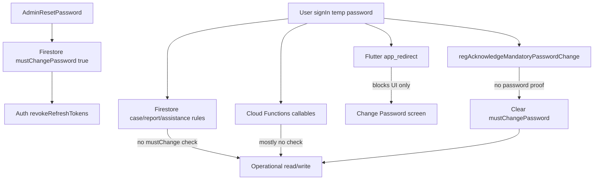
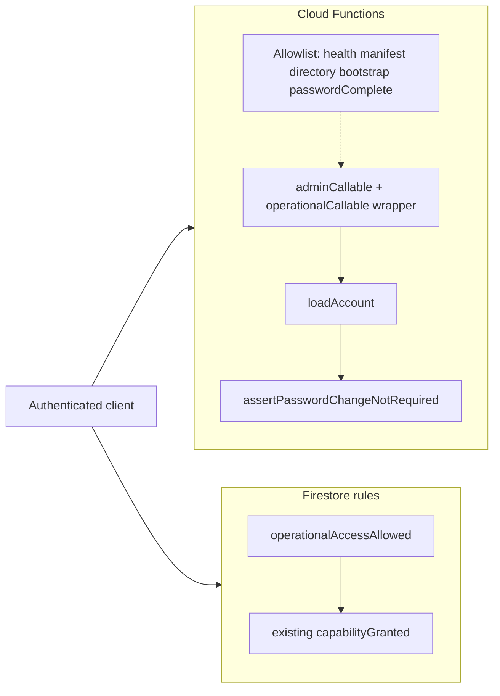

# SIBOL-REG-001 — Mandatory password change security investigation

**Investigation handover UUID:** `e5a91c73-8b46-4f20-9d62-3a7c58e104bf`  
**Investigation baseline:** Git `19bfc20` on `main` (read-only PLAN mode)  
**Cursor plan artifact (authoring):** `mandatory_password_enforcement_fb8ea7e7.plan.md` (Cursor local plans; content preserved in this repository file for EDF traceability)  
**Disposition (PA closure `b4e81c62-7d39-4a50-9f26-c3a108e75d92`):** Findings **DEFERRED — FUTURE PRODUCTION SECURITY REQUIREMENT**; not resolved for production. See [SIBOL_REG_001_PROTOTYPE_CLOSURE_EXECUTION_REPORT.md](SIBOL_REG_001_PROTOTYPE_CLOSURE_EXECUTION_REPORT.md).

---

# SIBOL-REG-001 — Mandatory Password Change Security Investigation

**Handover:** `e5a91c73-8b46-4f20-9d62-3a7c58e104bf`  
**Mode:** PLAN only — no implementation, commits, emulator changes, or production access.

---

## A. Baseline (verify at implementation time)

| Item | Expected |
|------|----------|
| Repo | [`/Users/edbecnel/Development/GitHub/SIBOL`](/Users/edbecnel/Development/GitHub/SIBOL) |
| Branch / HEAD | `main` @ **`19bfc20`** |
| Tag | `sibol-prototype-2026-10-26-offline-qa` → `807a324` (unchanged) |
| Investigation | **No source edits** in this handover |

**Files inspected (representative):**

- [`shared/functions/src/index.ts`](shared/functions/src/index.ts) — all exports
- [`shared/functions/src/authz/assert.ts`](shared/functions/src/authz/assert.ts) — `assertPasswordChangeNotRequired`
- [`shared/functions/src/admin/acknowledgeMandatoryPasswordChange.ts`](shared/functions/src/admin/acknowledgeMandatoryPasswordChange.ts)
- [`shared/functions/src/admin/resetStaffMemberPassword.ts`](shared/functions/src/admin/resetStaffMemberPassword.ts)
- [`shared/functions/src/admin/provisionStaffMember.ts`](shared/functions/src/admin/provisionStaffMember.ts)
- [`shared/functions/src/admin/operations.ts`](shared/functions/src/admin/operations.ts)
- [`shared/functions/src/coordination/createCoordinationReferral.ts`](shared/functions/src/coordination/createCoordinationReferral.ts)
- [`shared/functions/src/teen/acknowledgeTeenAssistanceRequest.ts`](shared/functions/src/teen/acknowledgeTeenAssistanceRequest.ts)
- [`firestore.rules`](firestore.rules)
- [`sibol_app/lib/core/router/app_redirect.dart`](sibol_app/lib/core/router/app_redirect.dart)
- [`sibol_app/lib/features/auth/presentation/screens/change_password_screen.dart`](sibol_app/lib/features/auth/presentation/screens/change_password_screen.dart)
- [`sibol_app/lib/main_common.dart`](sibol_app/lib/main_common.dart) — `persistenceEnabled: true`
- [`shared/firestore-rules-test/`](shared/firestore-rules-test/) — rules test harness (no `mustChangePassword` tests today)

---

## Executive answer

**Yes — a reset staff member can access protected functionality before completing mandatory password change**, by:

1. **Direct Firestore** (online): rules gate on role/capability only; **`mustChangePassword` is never evaluated** in [`firestore.rules`](firestore.rules).
2. **Most Cloud Functions**: only **two** operational paths call `assertPasswordChangeNotRequired` today ([`provisionStaffMember.ts`](shared/functions/src/admin/provisionStaffMember.ts), [`createCoordinationReferral.ts`](shared/functions/src/coordination/createCoordinationReferral.ts)).
3. **Hollow acknowledgment**: [`regAcknowledgeMandatoryPasswordChange`](shared/functions/src/admin/acknowledgeMandatoryPasswordChange.ts) clears `mustChangePassword` if the flag is true — **no verification** that Auth password changed after `passwordResetAt`.
4. **Flutter routing** blocks normal navigation but is **not** a security boundary (callable/Firestore clients bypass it).

**Token revocation** ([`resetStaffMemberPassword.ts`](shared/functions/src/admin/resetStaffMemberPassword.ts) `revokeRefreshTokens`) invalidates **refresh** tokens; **short-lived ID tokens** may remain valid until expiry (~1 hour), amplifying Firestore/Functions gaps if rules/functions do not enforce the flag.



---

## B. Cloud Functions inventory

**Pattern:** `adminCallable` in [`index.ts`](shared/functions/src/index.ts) only maps `AuthzError` → `HttpsError`; it does **not** load account or check `mustChangePassword`.

| Export | Source | Auth | Operational data? | `mustChangePassword` check | Bypass risk | Recommended action |
|--------|--------|------|-------------------|---------------------------|-------------|-------------------|
| `healthCheck` | index | None | No | N/A | None | Keep public |
| `submitReport` | index | Auth | N/A (disabled) | No | Low | N/A |
| `createCoordinationReferral` | createCoordinationReferral | Barangay + caps | **Create** referral | **Yes** (`assertPasswordChangeNotRequired`) | Low if rules also fixed | Keep check; add central wrapper for consistency |
| `bootstrapCentralAdminForEmulator` | operations | Emulator | Admin bootstrap | No | Emulator-only | Allowlist bypass |
| `regGetReferenceManifest` | geo | None | No | N/A | None | Keep public |
| `regListBarangayDirectory` | teen | None | Directory list | No | Low (no auth) | Keep public |
| `regRegisterTeenAccount` | teen | Teen auth | Profile create | No | N/A for staff | Optional teen gate later |
| `regSubmitTeenAssistanceRequest` | teen | Teen | **Create** assistance | No | N/A for staff | Out of staff scope |
| `regAcknowledgeTeenAssistanceRequest` | teen | Barangay + cap | **Update** assistance | **No** | **High** for barangay staff under mandatory change | Add `assertPasswordChangeNotRequired` |
| All `reg*` admin (org, invite, membership, provision, reset, list memberships, etc.) | operations / provision / reset | Org admin / central | **Read/write** admin data | **No** (except provision actor) | **High** for org admin under mandatory change; **High** for staff-targeted ops via other paths | Central gate on `adminCallable` with allowlist |
| `regProvisionStaffMember` | provisionStaffMember | Org admin | **Create** user/membership | **Yes** (actor) | Medium | Keep |
| `regResetStaffMemberPassword` | resetStaffMemberPassword | Org admin | **Auth password** target | No on actor | Low (actor is admin, not reset target) | Optional actor gate |
| `regAcknowledgeMandatoryPasswordChange` | acknowledgeMandatoryPasswordChange | Self | Clears flag | **Inverse** (requires flag true) | **Critical** — clears without password proof | **Replace** with verified rotation callable (see §E) |

**Essential during mandatory change (must remain reachable):**

- Auth sign-in / token refresh (Firebase Auth, not Functions)
- **New** server-verified password completion callable (replaces hollow acknowledge)
- Self read `users/{uid}` (rules already allow) for profile stream / router

**Not essential for operational staff during mandatory change:** all other callables above.

---

## C. Firestore rules inventory

**Finding:** **Zero** references to `mustChangePassword` in [`firestore.rules`](firestore.rules). [`users/{userId}`](firestore.rules) client update is limited to `displayName` only — **SEC-05 satisfied** (client cannot clear flag).

| Path | Staff access (typical) | `mustChangePassword` in rules | Exposure if flag true | Recommended action |
|------|------------------------|-------------------------------|------------------------|-------------------|
| `users/{self}` | read self | No | Read flag (required) | Allow read; deny operational writes elsewhere |
| `organizationMemberships/{self}` | read own | No | Read membership | Allow read (for context); optional deny if PA prefers stricter UX |
| `organizations/{orgId}` | read if member | No | Read org | Allow read |
| `organizationDirectory/{orgId}` | get | No | Read directory | Allow read |
| `cases/**` | read/write via `case.read` / `case.write` | **No** | **Read/write cases & followUps** | Add `operationalAccessAllowed()` to `canReadCaseOrg` / `canWriteCaseOrg` |
| `reports/{reportId}` | read/create via `report.submit` | **No** | **Submit aggregate reports** | Add predicate to create + barangay read helpers |
| `teenAssistanceRequests` | read; update acknowledge | **No** | **Acknowledge via client rules path** (callable also used) | Add predicate to `barangayCanAccessAssistanceRequest` / acknowledge update |
| `caseCoordinationThreads/**` | read | **No** | **Read coordination** | Add predicate to barangay/MOPH read helpers |
| `barangayCoordinationRegistry` | read | **No** | Read registry | Add predicate |
| Admin-only collections (audit, invitations, idempotency, staffProvisioning) | deny all | N/A | None | No change |

**Proposed rules helper** (conceptual):

```javascript
function operationalAccessAllowed() {
  return isActiveUser()
      && (!('mustChangePassword' in userDoc()) || userDoc().mustChangePassword != true);
}
```

Compose into existing capability helpers (not into `isActiveUser()` globally, to avoid breaking self-profile read).

**Tests:** extend [`shared/firestore-rules-test/`](shared/firestore-rules-test/) (e.g. new `mandatory_password.rules.test.mjs`) — infrastructure exists; no tests today for this flag.

---

## D. Offline and session analysis

| Topic | Behavior | Risk |
|-------|----------|------|
| Firestore persistence | [`main_common.dart`](sibol_app/lib/main_common.dart) `persistenceEnabled: true` | **Cached reads** of cases/reports/coordination remain visible offline after reset — local UI/history exposure; **not** new server authorization |
| Queued writes | [`offline_sync_service.dart`](sibol_app/lib/features/offline/data/offline_sync_service.dart) queues teen assistance + coordination referral callables | On reconnect, **server** enforces Functions/rules; today **referral create is protected**, **ack assistance is not**; case/report writes go **direct to Firestore** and would succeed online if rules lack flag |
| Token revocation | `revokeRefreshTokens` on reset | Old refresh tokens invalid; **ID token** may work until expiry — rules/functions must deny |
| Flutter router | [`app_redirect.dart`](sibol_app/lib/core/router/app_redirect.dart) forces `changePassword` | Bypass via direct API; offline user may still navigate cached screens until profile stream updates |
| Profile stream | `users/{uid}` read | After hollow `acknowledge`, client sees `mustChangePassword: false` and router releases — **without** true password rotation |

**Safeguards (recommended):** Firestore + Functions gates (primary); do **not** rely on cache wipe (would harm O1–O8 offline QA). Accept documented **local cache read** limitation or add UI overlay when profile flag true (defense in depth only).

---

## E. Acknowledgment security (Investigation D)

**Current sequence gap:** Steps 6–7 (client `updatePassword`) and step 8 (`regAcknowledgeMandatoryPasswordChange`) are **decoupled**. Any authenticated user with `mustChangePassword: true` can call step 8 alone and clear the flag ([`acknowledgeMandatoryPasswordChange.ts`](shared/functions/src/admin/acknowledgeMandatoryPasswordChange.ts) lines 15–25).

**Evidence:** No read of `passwordResetAt`, Auth `tokensValidAfterTime`, or password-change timestamp; no comparison to a monotonic **reset generation** counter.

**SEC-06:** Fails today (acknowledge without password change succeeds).

**SEC-11:** Admin can set `passwordResetAt` again on second reset, but stale client could still call acknowledge once if flag is true — need **generation** field: reset increments `passwordResetGeneration`; completion must match.

**Recommended server-verifiable mechanism (smallest secure design):**

1. On admin reset: set `mustChangePassword: true`, `passwordResetAt`, increment **`passwordResetGeneration`** (integer).
2. **Deprecate** standalone `regAcknowledgeMandatoryPasswordChange` for production path.
3. Add **`regCompleteMandatoryPasswordChange`** (callable) accepting `currentPassword` + `newPassword`:
   - Verify `mustChangePassword` and load expected `passwordResetGeneration`.
   - Verify `currentPassword` server-side (Identity Toolkit `signInWithPassword` against emulator/prod — same pattern as secure rotation).
   - `auth.updateUser` new password; optionally `revokeRefreshTokens` again.
   - Clear `mustChangePassword` and set `passwordResetGenerationCleared` / match generation in Firestore transaction.
4. Flutter [`change_password_screen.dart`](sibol_app/lib/features/auth/presentation/screens/change_password_screen.dart): mandatory path calls **only** the new callable (remove client-only `updatePassword` + acknowledge split for mandatory flow). Voluntary change can remain client `updatePassword` without touching flag.

**Retries / concurrency:** Use transaction on `users/{uid}` with generation check; reject if generation changed (second admin reset).

---

## F. Proposed correction (preferred architecture)

### Architecture (two layers + allowlist)



1. **Functions:** Extend [`adminCallable`](shared/functions/src/index.ts) (and non-admin `onCall` wrappers for `createCoordinationReferral`, teen barangay ops) with shared **`requireOperationalAccount(db, uid)`** → `loadAccount` + `assertPasswordChangeNotRequired`, except explicit allowlist:
   - Public/unauth: `healthCheck`, `regGetReferenceManifest`, `regListBarangayDirectory`
   - Emulator: `bootstrapCentralAdminForEmulator`
   - Password lifecycle: **`regCompleteMandatoryPasswordChange`** (new; requires flag true, not false)
   - Teen-only registration/submit (staff scope exclusion per PA)
2. **Firestore:** Add `operationalAccessAllowed()` to all **operational** read/write predicates (cases, followUps, reports create/read, assistance barangay paths, coordination reads, assistance acknowledge update).
3. **Flutter:** Keep [`app_redirect.dart`](sibol_app/lib/core/router/app_redirect.dart) as UX gate only; wire mandatory flow to new callable.
4. **Do not** add custom claims unless PA requests (Firestore `userDoc()` already authoritative and rules-tested).

### Expected files to change (implementation authorization pending)

| Area | Files |
|------|--------|
| Authz | [`shared/functions/src/authz/assert.ts`](shared/functions/src/authz/assert.ts), new helper e.g. `requireOperationalAccount.ts` |
| Callable wiring | [`shared/functions/src/index.ts`](shared/functions/src/index.ts), [`shared/functions/src/admin/callable.ts`](shared/functions/src/admin/callable.ts) |
| Password lifecycle | Replace/deprecate [`acknowledgeMandatoryPasswordChange.ts`](shared/functions/src/admin/acknowledgeMandatoryPasswordChange.ts); new `completeMandatoryPasswordChange.ts`; update [`resetStaffMemberPassword.ts`](shared/functions/src/admin/resetStaffMemberPassword.ts) generation field |
| Teen/coordination | [`acknowledgeTeenAssistanceRequest.ts`](shared/functions/src/teen/acknowledgeTeenAssistanceRequest.ts) |
| Rules | [`firestore.rules`](firestore.rules) |
| Flutter | [`change_password_screen.dart`](sibol_app/lib/features/auth/presentation/screens/change_password_screen.dart), [`auth_repository_impl.dart`](sibol_app/lib/features/auth/data/repositories/auth_repository_impl.dart), [`admin_api.dart`](sibol_app/lib/features/admin/data/admin_api.dart) if needed |
| Tests | [`shared/functions/test/admin.resetStaffPassword.test.mjs`](shared/functions/test/admin.resetStaffPassword.test.mjs) + new mandatory-password tests; [`shared/firestore-rules-test/test/mandatory_password.rules.test.mjs`](shared/firestore-rules-test/test/mandatory_password.rules.test.mjs); [`sibol_app/test/app_redirect_test.dart`](sibol_app/test/app_redirect_test.dart) (unchanged behavior) |

### Security test matrix (SEC-01–SEC-12)

| ID | Intent | Layer | Existing infra |
|----|--------|-------|----------------|
| SEC-01 | Blocked operational callables when flag true | Functions integration (`admin.*`, `createCoordinationReferral`, `acknowledgeTeenAssistance`) | Yes — emulator harness in [`shared/functions/scripts/run-firestore-integration-tests.mjs`](shared/functions/scripts/run-firestore-integration-tests.mjs) |
| SEC-02 | Blocked server Firestore reads | Rules tests | Yes — [`shared/firestore-rules-test`](shared/firestore-rules-test) |
| SEC-03 | Blocked server Firestore writes | Rules tests | Yes |
| SEC-04 | Password completion callable works | Functions + Flutter widget test optional | Partial |
| SEC-05 | Client cannot clear flag | Rules test on `users` update | Yes — extend existing users rules tests |
| SEC-06 | Acknowledge without rotation rejected | Functions | New tests; **delete** hollow acknowledge or harden |
| SEC-07 | Valid rotation clears flag | Functions | New |
| SEC-08 | Post-reset refresh invalid; ID token window documented | Manual + optional Auth emulator test | Partial |
| SEC-09 | Queued offline writes rejected after fix | Rules + Functions integration | [`offline_sync_service_test.dart`](sibol_app/test/offline_sync_service_test.dart) for queue; add rules rejection case |
| SEC-10 | Normal access after completion | E2E integration | Smoke patterns in [`shared/integration`](shared/integration) |
| SEC-11 | Second reset invalidates stale completion | Functions transaction on generation | New |
| SEC-12 | Barangay/MOPH cap boundaries unchanged | Existing rules + org tests | [`org_scoped_security.rules.test.mjs`](shared/firestore-rules-test/test/org_scoped_security.rules.test.mjs) |

### Complexity and regression

- **Estimate:** Medium (2–3 focused days within Oct 29 boundary): ~1 day Functions wrapper + password callable, ~1 day rules + rules tests, ~0.5 day Flutter + integration tests.
- **Regression risks:** Over-broad `operationalAccessAllowed()` breaking self `users` read or membership read; blocking central admin during emergency; offline QA if rules block reads PA still wants cached.
- **Migration:** Add `passwordResetGeneration` default `0` for users without field; old `regAcknowledgeMandatoryPasswordChange` callers must switch to new callable.

### If boundary cannot fit comprehensive fix

**PA alternative (secure restricted):** **Disable `regResetStaffMemberPassword`** (feature flag or callable returns `failed-precondition`) until Functions + rules enforcement ships — do not silently ship partial protection. Document in EDF; manual PR-* QA remains blocked.

---

## G. Decisions requiring PA approval

1. **Accept local cached read exposure** after reset while offline (no server recall) vs. aggressive client cache policy (may affect O1–O8).
2. **Server-side password rotation callable** (recommended) vs. attempting Auth metadata-only verification (weak on emulator).
3. **Whether org administrators under mandatory change** may still run **staff reset/provision** (recommend: **no** — same `assertPasswordChangeNotRequired` on actor).
4. **Deprecate vs. harden** `regAcknowledgeMandatoryPasswordChange` (recommend deprecate for mandatory path).
5. **Interim:** disable admin password reset until enforcement complete?
6. **Teen paths:** scope mandatory flag to staff only in v1 or unify for all roles.

---

## H. Completion boundary (this handover)

- **No code changes, Firebase data changes, emulator restart, commits, pushes, or production access.**
- **Do not resume** administrator password-reset manual QA (PR-*, MF-*) until PA authorizes implementation and re-runs readiness.
- Return findings to PA for implementation authorization.
